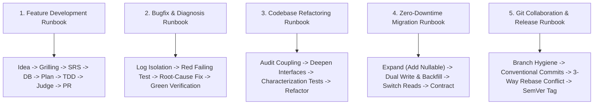

<div align="center">

# 🛠️ Agents-Kit: The Autonomous AI Engineering Hub

**Production-grade repository of 85 Curated Skills, 12 Specialized Subagents, 5 Production Workflows, and Core Engineering Principles (SOLID, YAGNI, KISS, DRY) for Antigravity, Claude Code, GitHub Copilot, Cursor, and Windsurf.**

[](skills/)
[](agents/)
[](workflows/recipes/)
[](skills/ops-guardrails/context-engineering-and-subagents/)
[](LICENSE)

</div>

---

## 🌟 The 5 Standard Engineering Workflows (Recipes)

Agents-kit provides deterministic, step-by-step runbooks in `workflows/recipes/` that guide both agents and developers through every engineering event:



| Runbook | Scenario | Path | Deliverable |
| :--- | :--- | :--- | :--- |
| **[Workflow 1: Feature Development](workflows/recipes/01-feature-development-workflow.md)** | Building a new feature from scratch | Idea $\rightarrow$ Grilling $\rightarrow$ SRS $\rightarrow$ DB $\rightarrow$ TDD $\rightarrow$ PR | Verified Feature + PR |
| **[Workflow 2: Bugfix & Diagnosis](workflows/recipes/02-bugfix-and-diagnosis-workflow.md)** | Production error or bug report | Log Filter $\rightarrow$ Failing Test $\rightarrow$ Root Fix $\rightarrow$ Regression suite | Regression test + Hotfix |
| **[Workflow 3: Codebase Refactoring](workflows/recipes/03-refactoring-and-deep-modules-workflow.md)** | Untangling spaghetti or shallow modules | Coupling Scan $\rightarrow$ Seam Identification $\rightarrow$ Stepwise TDD | Deep Module Architecture |
| **[Workflow 4: Zero-Downtime DB Migration](workflows/recipes/04-database-migration-workflow.md)** | Modifying live production schemas | Expand $\rightarrow$ Dual-Write/Backfill $\rightarrow$ Switch Reads $\rightarrow$ Contract | Zero-Downtime DDL |
| **[Workflow 5: Git Collaboration & Release](workflows/recipes/05-git-collaboration-and-release-workflow.md)** | Resolving conflicts or tagging releases | Conventional Commits $\rightarrow$ 3-Way Rebase Conflict $\rightarrow$ PR $\rightarrow$ SemVer | Clean Git History & Release Tag |

---

## 🏛️ Pragmatic Design Patterns Standards

Included in `skills/architecture-domain/design-patterns/`:
- **Creational**: Factory Method, Fluent Builders with invariant validation.
- **Structural**: Adapter (third-party isolation), Decorator/Middleware pipelines, Facade (subsystem simplification).
- **Behavioral**: Strategy (swappable algorithms/payment providers), Observer / Domain Events (decoupling side-effects), Chain of Responsibility.
- **Architectural**: Clean Architecture / Hexagonal (Ports & Adapters), Repository & Unit of Work.
- **Distributed & Cloud**: Circuit Breaker (failure containment), Transactional Outbox (dual-write consistency), CQRS (read/write segregation).
- **The Anti-Pattern Rule (YAGNI)**: Explicit guardrails against premature abstraction and "pattern bloat".

---

## 🤖 12 Specialist Subagents (`agents.toml`)

| Subagent Name | Role | Core Skills & Focus |
| :--- | :--- | :--- |
| **`system_coordinator`** | Technical Planner & SRS Author | `srs-authoring`, `wayfinder`, `grill-me`, `to-spec`, `to-tickets` |
| **`database_architect`** | Database Architect & Data Modeler | `database-design`, `domain-modeling`, `codebase-design`, ERDs |
| **`devops_engineer`** | DevOps & Cloud Deployment Engineer | `docker-and-containerization`, `cloud-and-production-deploy`, `git-conflict-resolution`, `github-pr-and-collaboration` |
| **`frontend_architect`** | Frontend Architect & System Planner | `ui-ux-pro-max`, `design-system`, `codebase-design`, `writing-plans` |
| **`ui_ux_designer`** | UI/UX Intelligence Specialist | `ui-ux-pro-max`, `design-system`, `ui-styling`, `frontend-ui-engineering` |
| **`taste_craftsman`** | Anti-Slop Art Director | `design-taste-frontend`, `minimalist-skill`, `brutalist-skill`, `brandkit` |
| **`frontend_developer`** | Frontend Component Implementer | `test-driven-development`, `incremental-implementation`, `code-simplification` |
| **`qa_reviewer`** | QA, Accessibility & Code Reviewer | `verification-before-completion`, `code-review-excellence`, `browser-testing-with-devtools` |
| **`web_performance_auditor`** | Web Performance & Core Web Vitals | `performance-optimization`, `observability-and-instrumentation` |
| **`java_pro`** | Java & JVM Engineering Specialist | `debugging-strategies`, `error-handling-patterns`, Java 17+, Spring Boot |
| **`python_backend`** | Python Architecture Specialist | `pydantic-v2`, `python-type-safety`, `python-testing-patterns` |
| **`security_auditor`** | Application Security Specialist | `stride-analysis-patterns`, `attack-tree-construction`, `sast-configuration` |

---

## 📁 Repository Layout & Built-in Templates

```text
Agents-kit/
├── bin/
│   └── agents-kit                  # Fast CLI manager (install, audit, list)
├── skills/                         # 84 Curated Skills across 8 domains
│   ├── planning-grilling/          # 10 skills (grill-me, SRS authoring, to-tickets...)
│   ├── architecture-domain/        # 10 skills (design-patterns, database-design, deep-modules...)
│   ├── engineering-core/           # 14 skills (TDD, debugging, simplification, review...)
│   ├── design-uiux/                # 14 skills (ui-ux-pro-max, taste-skill, tokens, perf...)
│   ├── security-threat/            # 7 skills (STRIDE, attack trees, SAST, sanitizer...)
│   ├── stacks/                     # 9 skills (Python Pydantic v2, JVM, TS deep modules...)
│   ├── ops-guardrails/             # 14 skills (workflows, docker, deploy, git-conflicts, context...)
│   └── documents-media/            # 6 skills (README crafting, DOCX, PDF, PPTX, XLSX...)
├── workflows/
│   ├── recipes/                    # 5 Executable Step-by-Step Runbooks
│   │   ├── 01-feature-development-workflow.md
│   │   ├── 02-bugfix-and-diagnosis-workflow.md
│   │   ├── 03-refactoring-and-deep-modules-workflow.md
│   │   ├── 04-database-migration-workflow.md
│   │   └── 05-git-collaboration-and-release-workflow.md
│   ├── templates/                  # 10 Production Markdown Templates:
│   │   ├── README-TEMPLATE.md      # High-impact GitHub README template
│   │   ├── SRS-TEMPLATE.md         # IEEE 830 Software Requirements Spec
│   │   ├── DATABASE-SCHEMA-TEMPLATE.md # DDL & Mermaid ERD schema
│   │   ├── DOCKERFILE-PATTERNS.md  # Multi-stage Dockerfiles (Node/Python/Java)
│   │   ├── GITHUB-ACTIONS-WORKFLOW.md # CI/CD pipeline template
│   │   ├── PR-TEMPLATE.md          # High-signal Pull Request template
│   │   ├── ADR-TEMPLATE.md         # Architecture Decision Record
│   │   ├── GLOSSARY-TEMPLATE.md    # Domain terminology glossary
│   │   ├── SPEC-TEMPLATE.md        # Feature specification
│   │   └── TICKET-TEMPLATE.md      # Tracer-bullet ticket template
│   └── hooks/
│       └── context-mode.json       # Context Mode integration hook
├── agents/
│   ├── agents.toml                 # Master subagent configuration
│   └── profiles/                   # 12 Markdown agent profiles (*.agent.md)
└── rules/
    ├── AGENTS.md                   # Single source of truth guidelines
    └── copilot-instructions.md     # Editor AI token hygiene rules
```

---

## 🚀 CLI Quickstart

```bash
# 1. View all 84 skills, 12 subagents, and workflows
/home/hien/Project/Agents-kit/bin/agents-kit list

# 2. Install everything into any repository
/home/hien/Project/Agents-kit/bin/agents-kit install /path/to/my-project

# 3. Specialized presets:
/home/hien/Project/Agents-kit/bin/agents-kit install /path/to/web-app --preset web
/home/hien/Project/Agents-kit/bin/agents-kit install /path/to/api-service --preset backend
/home/hien/Project/Agents-kit/bin/agents-kit install /path/to/infra --preset devops

# 4. Audit project health
/home/hien/Project/Agents-kit/bin/agents-kit audit /path/to/my-project
```

---

## 📄 License
MIT. Built for modern autonomous engineering teams.
