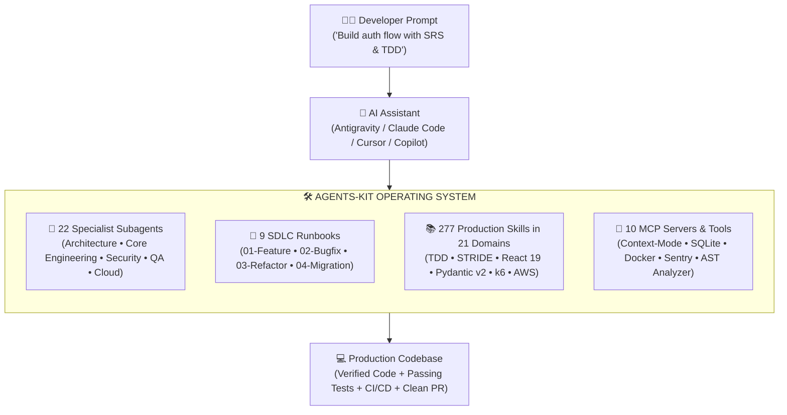
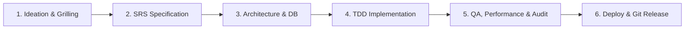

<div align="center">

# 🛠️ Agents-Kit: The Autonomous AI Engineering OS
### Enterprise Skills, Specialized Subagent Squads, SDLC Runbooks & Context Optimization

**Transform your AI Assistant into an elite, full-lifecycle software engineering team.**<br/>
*Native compatibility with Google Antigravity, Claude Code, Cursor, Windsurf, and GitHub Copilot.*

[](https://github.com/hienpham0344/Agent-kit)
[](skills/)
[](skills/)
[](agents/)
[](workflows/recipes/)
[](workflows/templates/)
[](references/)
[](mcp/)
[](tools/token_estimator.py)
[](tests/)
[](LICENSE)

<br/>

<p align="center">
  <a href="#-what-is-agents-kit"><b>What is Agents-Kit?</b></a> •
  <a href="#-installation--setup-guide"><b>Installation Guide</b></a> •
  <a href="#-how-to-use-it-day-to-day"><b>Daily Usage</b></a> •
  <a href="#-the-6-stage-autonomous-sdlc"><b>SDLC Lifecycle</b></a> •
  <a href="#-the-22-specialist-subagents"><b>22 Subagents</b></a> •
  <a href="#-the-9-standard-runbooks"><b>9 Runbooks</b></a> •
  <a href="#-21-skill-domains-catalog-277-skills"><b>277 Skills</b></a> •
  <a href="#-cli-suite--developer-tools"><b>CLI Tools</b></a> •
  <a href="#-token-hygiene-protocol"><b>Token Protocol</b></a> •
  <a href="#-faq"><b>FAQ</b></a>
</p>

</div>

---

## 💡 What is Agents-Kit?

When developers build complex software with AI assistants, generalist models often produce shallow code, hallucinate dependencies, or suffer from severe **context degradation** when dumping thousands of lines into conversation memory.

**Agents-Kit is a universal engineering operating system that turns your AI assistant into an organized, battle-tested software engineering organization.**

With a single CLI command (`agents-kit install .`), Agents-Kit equips any codebase with:

- 👥 **22 Specialized AI Subagents**: Dedicated engineering personas (Architects, Frontend, Backend, QA, SRE, Red Team, Cloud).
- 📚 **277 Production Skills**: Deep, deterministic procedures across 21 technical domains (TDD, Pydantic v2, STRIDE, React 19, k6, Terraform).
- 📖 **9 Production SDLC Runbooks**: Battle-tested recipes guiding your AI step-by-step from raw idea → IEEE 830 SRS → Schema Design → TDD Implementation → QA → Production Release.
- 🔌 **10 Integrated MCP Servers**: Sandbox execution, database schema profiling, Puppeteer UI diffs, Sentry triage, and container logs.
- 🛡️ **Token Hygiene & Context-Mode Protocol**: Prevents context rot and saves **up to 98% of LLM context tokens** using sandboxed execution and precision slicing.

### System Architecture



---

## ⚡ Installation & Setup Guide

Agents-Kit can be installed in **under 2 minutes** across Linux, macOS, and Windows (WSL2).

### 1. Prerequisites & Compatibility

Before starting, verify your environment meets the minimum requirements:

| Requirement | Minimum Version | Verification Command | Status & Purpose |
| :--- | :--- | :--- | :--- |
| **Operating System** | Linux, macOS, or WSL2 | `uname -s` | **Required** (Native Unix filesystem & symlink support) |
| **Python** | 3.10+ | `python3 --version` | **Required** (CLI manager, AST analyzer, and test suite) |
| **Git** | 2.25+ | `git --version` | **Required** (Cloning repositories, submodule & worktree ops) |
| **Node.js / npm** | 18+ | `node -v` | **Recommended** (Running MCP servers like context-mode, puppeteer) |
| **Docker** | 24+ | `docker -v` | **Optional** (Containerization recipes and load-testing swarms) |

---

### 2. Step 1: Clone Agents-Kit & Register Global CLI

Clone the repository to a permanent location on your machine (e.g. `~/Project/Agents-kit`) and register the `agents-kit` command in your shell:

```bash
# 1. Clone repository
git clone https://github.com/hienpham0344/Agent-kit.git ~/Project/Agents-kit
cd ~/Project/Agents-kit

# 2. Add executable to your shell PATH
# Option A: For Bash (Ubuntu/Debian/Fedora):
./bin/agents-kit setup-env
source ~/.bashrc

# Option B: For Zsh (macOS / Oh My Zsh):
echo 'export PATH="'$PWD'/bin:$PATH"' >> ~/.zshrc
source ~/.zshrc

# 3. Verify health & dependency integrity
agents-kit doctor
```

> [!TIP]
> **No-PATH / One-Shot Alternative:**
> If you prefer not to modify your shell profile, you can run the binary directly via its absolute path:
> ```bash
> ~/Project/Agents-kit/bin/agents-kit install /path/to/my-project
> ```

---

### 3. Step 2: Install into Your Target Software Project

Navigate to any software project directory (new or existing) on your system:

```bash
cd /path/to/my-project
```

#### Choose Your Installation Method:

```bash
# Method A: Auto-detected Stack (Recommended)
# Automatically scans project files (package.json, pom.xml, pyproject.toml, etc.)
agents-kit install . --preset auto

# Method B: Full Enterprise Suite
# Injects all 277 skills, 22 subagents, 9 runbooks, 18 templates & 6 cookbooks
agents-kit install . --preset full

# Method C: Standalone Copy Mode (For Team Sharing & CI/CD)
# Copies files instead of creating symlinks (so skills can be committed to Git)
agents-kit install . --preset auto --copy
```

#### Available Presets Reference

| Preset | Target Tech Stack | Curated Categories Included |
| :--- | :--- | :--- |
| `auto` *(Recommended)* | Auto-detected | Intelligently inspects project files (`package.json`, `pom.xml`, `pyproject.toml`, etc.) |
| `full` | Enterprise Suite | **All 21 domains** (277 skills, 22 subagents, 9 runbooks, 18 templates, 6 cookbooks) |
| `web` | Frontend & Fullstack | `planning-grilling`, `engineering-core`, `design-uiux`, `frontend-mastery`, `ops-guardrails` |
| `backend` | Servers, APIs & DB | `planning-grilling`, `engineering-core`, `architecture-domain`, `security-threat`, `stacks`, `ops-guardrails` |
| `devops` | Cloud & Infrastructure| `ops-guardrails`, `security-threat`, `cloud-infra`, `sre-observability`, `cloud-aws-gcp-azure` |
| `security` | Red / Blue Team | `security-threat`, `security-redteam`, `ops-guardrails`, `engineering-core` |
| `minimal` | Lightweight Core | Core TDD, basic planning, systematic debugging, and essential guardrails |

#### Real Installation Output Preview:
```text
🔎 Auto-detected stack: Web/Frontend (package.json)

🚀 Installing Agents-kit to: /home/dev/my-project
   Preset: FULL (Categories: 21 domains)
   Mode:   SYMLINK
------------------------------------------------------------
✅ Successfully installed 277 skills into .agents/skills/
✅ Synced .agents/agents.toml
✅ Synced AGENTS.md & .cursorrules
✅ Synced .github/copilot-instructions.md & .github/hooks/context-mode.json
✅ Synced 22 agent profiles into .github/agents/
✅ Synced 9 workflows into docs/workflows/
✅ Synced 18 templates into docs/templates/
✅ Synced 6 reference guides into docs/references/
```

---

### 4. Step 3: What Gets Added to Your Project?

Agents-Kit generates a clean, organized, standard layout inside your repository:

```
my-project/
├── .agents/
│   ├── agents.toml                 # Active registry for 22 specialized subagents
│   └── skills/                     # 277 Symlinked (or copied) skill folders
├── AGENTS.md                       # Master engineering rules (Antigravity & Claude Code)
├── .cursorrules                    # Project rules natively read by Cursor IDE
├── .github/
│   ├── agents/*.agent.md           # 22 Standalone subagent profiles
│   ├── copilot-instructions.md     # Workspace instructions for GitHub Copilot
│   └── hooks/context-mode.json     # Context-saving shell hook
└── docs/
    ├── workflows/                  # 9 Production SDLC runbooks (Feature, Bugfix, etc.)
    ├── templates/                  # 18 Standard templates (SRS, ADR, DB schema, k6)
    └── references/                 # 6 Frontend & architectural cookbooks
```

---

### 5. Step 4: AI IDE & Editor Activation

How does your AI assistant automatically discover Agents-Kit? **No extra plugins or extensions required:**

| AI Editor / Tool | Discovery Mechanism | What to Do Next |
| :--- | :--- | :--- |
| **Google Antigravity** | Automatically reads `.agents/agents.toml`, `.agents/skills/`, and `AGENTS.md` | Open project folder in Antigravity. Subagents and skills are immediately active. |
| **Cursor IDE** | Automatically reads `.cursorrules` in project root | Open project in Cursor. Agent personas and rules are automatically loaded into Chat & Composer. |
| **Claude Code (CLI)** | Automatically reads `AGENTS.md` in the current working directory | Run `claude` inside your project root. Prompt your agent with runbooks and skills. |
| **Windsurf / Cascade** | Reads `AGENTS.md` and `.cursorrules` | Open workspace in Windsurf. Cascade inherits all behavioral guidelines. |
| **GitHub Copilot** | Automatically reads `.github/copilot-instructions.md` | Open project in VS Code or JetBrains. Copilot Chat immediately follows project rules. |

---

### 6. Step 5: Updating, Syncing & Clean Uninstallation

#### Keeping Skills Updated
```bash
# 1. Update core Agents-Kit
cd ~/Project/Agents-kit
git pull origin main

# In Symlink mode (Default):
# All your connected projects automatically reflect new skills immediately!

# In Copy mode (or to re-sync templates & runbooks):
cd /path/to/my-project
agents-kit sync .
```

#### Clean Uninstallation
If you ever want to remove Agents-Kit from a project, your source code and git history remain 100% untouched:
```bash
cd /path/to/my-project
rm -rf .agents .cursorrules AGENTS.md .github/agents .github/copilot-instructions.md docs/workflows docs/templates docs/references
```

---

## 💬 How to Use It Day-to-Day

Once installed in your project, you interact with your AI assistant (Google Antigravity, Claude Code, Cursor, Copilot) as you normally would. **Simply invoke the relevant subagent persona or runbook recipe:**

### 🚀 Scenario 1: Building a New Feature from Scratch
> **Your Prompt:**
> *"I want to implement a user subscription billing flow with Stripe. Follow workflow `01-feature-development-workflow.md`. Have `system_coordinator` conduct a quick grilling interview and write the SRS, `database_architect` design the subscription schema, and `backend_developer` implement it using strict TDD."*

### 🐛 Scenario 2: Diagnosing and Fixing a Production Regression
> **Your Prompt:**
> *"Users are reporting intermittent 500 errors during checkout. Follow `02-bugfix-and-diagnosis-workflow.md`. Use `systematic-debugging` and `sre_specialist` to isolate the root cause, write a reproduction test that fails, and fix the issue without regressions."*

### 🛡️ Scenario 3: Security & Code Review Pre-Merge
> **Your Prompt:**
> *"Act as `security_auditor` and `qa_reviewer`. Perform a STRIDE threat modeling analysis on `src/auth/` and review our latest pull request against the WCAG AA accessibility checklist."*

### 🎨 Scenario 4: Creating a Polished, Anti-AI-Slop Landing Page
> **Your Prompt:**
> *"Act as `taste_craftsman` and `frontend_developer`. Implement the landing page hero section following `design-taste-frontend`. Use distinctive editorial typography and fluid spacing, and avoid generic purple AI gradients."*

---

## 🔄 The 6-Stage Autonomous SDLC

Agents-Kit organizes every software initiative into a deterministic, test-driven 6-stage lifecycle:



| Phase | Core Objective | Key Skills | Lead Subagent | Primary Output |
| :--- | :--- | :--- | :--- | :--- |
| **1. Ideation** | Discovery, technical grilling, and stress-testing | `brainstorming`, `idea-refine`, `grill-me`, `wait-what` | `system_coordinator` | Concept Brief & Scope |
| **2. SRS** | Formal requirements (IEEE 830) & tracer-bullet tickets | `srs-authoring`, `to-spec`, `to-tickets`, `wayfinder` | `system_coordinator` | `docs/srs/SRS-*.md`, tickets |
| **3. Architecture** | Relational & NoSQL modeling, ERDs, DDL schemas | `database-design`, `domain-modeling`, `codebase-design` | `database_architect` | `docs/database/*.md`, DDL |
| **4. Coding** | Deep module architecture, TDD, and atomic edits | `test-driven-development`, `incremental-implementation` | `frontend_developer`, `python_backend` | Verified code + passing tests |
| **5. QA & Audit** | Two-axis review, Web Vitals, accessibility, STRIDE, load | `verification-before-completion`, `k6-high-concurrency-testing` | `qa_reviewer`, `security_auditor` | Audit report & sign-off |
| **6. Release** | Docker builds, CI/CD, rebase resolution, PRs & release tags | `docker-and-containerization`, `cloud-and-production-deploy` | `devops_engineer`, `cloud_architect` | Dockerfile, CI/CD, PR & tag |

---

## 🤖 The 22 Specialist Subagents

Organized into 6 specialized engineering squads defined in [`agents/agents.toml`](agents/agents.toml) and [`agents/profiles/`](agents/profiles/):

| Squad | Agent Persona | Specialization & Focus | When to Summon |
| :--- | :--- | :--- | :--- |
| **🏗️ Planning & Architecture** | `system_coordinator` | Requirements discovery, IEEE 830 SRS specs, epic decomposition | Starting major features or planning |
| | `database_architect` | PostgreSQL, MySQL, SQLite, Mermaid ERDs, zero-downtime migrations | Designing schemas, queries, indexes |
| | `frontend_architect` | Component hierarchy, state architecture, token-disciplined plans | Designing complex frontend layouts |
| **🎨 Design & Visuals** | `ui_ux_designer` | Color harmony, typography pairings, WCAG AA/AAA accessibility | Designing design systems and UI tokens |
| | `taste_craftsman` | Anti-slop art direction, bespoke typography, editorial styling | Polishing pages to look high-end |
| **💻 Core Stacks** | `frontend_developer` | React 19, Next.js 15, Tailwind v4, headless primitives, TDD | Implementing UI components |
| | `python_backend` | Python 3.12+, Pydantic v2, pytest suites, clean architecture | Building APIs, schemas, backend logic |
| | `java_pro` | Java 17/21, Spring Boot, Maven/Gradle, JVM performance | Enterprise Java services, builds |
| | `mobile_dev` | React Native, Expo Router v3, EAS CI/CD, offline-first sync | iOS/Android app development |
| | `graphics_web_dev` | Three.js WebGL 3D, WebRTC streaming, Framer Motion, Tauri apps | Interactive 3D, canvas, desktop apps |
| | `systems_engineer` | Rust, WebAssembly, C/C++ memory safety (ASan), Linux eBPF | Low-level systems, WASM, performance |
| **🧪 QA, SRE & Testing** | `qa_reviewer` | Two-axis code review, accessibility audit, pre-completion proof | Reviewing PRs, verifying fixes |
| | `load_tester` | Grafana k6 benchmarks, Locust distributed swarms, chaos injection | Stress testing, concurrency tuning |
| | `sre_specialist` | Datadog APM tracing, Prometheus metrics, SLO error budgets, RCA | Diagnosing incidents, monitoring |
| | `web_performance_auditor` | Core Web Vitals (LCP, CLS, INP), bundle tree-shaking | Optimizing browser performance |
| **🔐 Security Squad** | `security_auditor` | STRIDE threat modeling, attack trees, SAST, input sanitization | Pre-merge security reviews, threat scans |
| | `redteam_security` | OWASP Top 10 mitigation, container escape defense, secret scan | Hardening APIs, penetration tests |
| **☁️ Cloud & Data** | `devops_engineer` | Docker multi-stage builds, GitHub Actions CI/CD, Git conflicts | Containerization, CI/CD pipelines |
| | `cloud_architect` | Terraform IaC, Cloudflare edge compute, Supabase, Kubernetes Helm | Infrastructure as code, serverless |
| | `cloud_platform_lead` | Multi-cloud architecture (AWS, GCP, Azure), Karpenter, BigQuery | Enterprise cloud platforms |
| | `data_scientist` | DuckDB, Polars lazy frames, dbt transforms, PyTorch deep learning | Data pipelines, ML models, analytics |
| | `ai_engineer` | RAG evaluations, prompt regression matrices, vector DBs, OpenLLMetry | Building AI/LLM apps and evals |

---

## 📖 The 9 Standard Runbooks (`workflows/recipes/`)

Deterministic, step-by-step engineering playbooks for human developers and autonomous AI assistants:

| Runbook | Scenario | Step-by-Step Execution Pipeline | Deliverable |
| :--- | :--- | :--- | :--- |
| **[01. Feature Development](workflows/recipes/01-feature-development-workflow.md)** | Building features from scratch | Idea → Grilling → SRS → DB → TDD → QA → PR | Verified Feature + PR |
| **[02. Bugfix & Diagnosis](workflows/recipes/02-bugfix-and-diagnosis-workflow.md)** | Production bugs / regressions | Log Filter → Failing Test → Root Fix → Regression Suite | Regression Test + Hotfix |
| **[03. Codebase Refactoring](workflows/recipes/03-refactoring-and-deep-modules-workflow.md)** | Untangling spaghetti architecture | Coupling Scan → Seams → Characterization Tests → Refactor | Deep Module Architecture |
| **[04. Zero-Downtime Migration](workflows/recipes/04-database-migration-workflow.md)** | Modifying live production schemas | Expand → Dual-Write/Backfill → Switch Reads → Contract | Zero-Downtime DDL |
| **[05. Git Collaboration](workflows/recipes/05-git-collaboration-and-release-workflow.md)** | Branching, merges, rebase conflicts | Conventional Commits → 3-Way Rebase Conflict → PR → SemVer | Clean Git History & Release Tag |
| **[06. AI Model Evaluation](workflows/recipes/ai-model-evaluation.md)** | Prompt regression & RAG benchmarking | Evals Matrix → Faithfulness & Context Recall → Token Budgets | Quality Gate Pass |
| **[07. Pre-Deploy Load Testing](workflows/recipes/k6-load-test-pipeline.md)** | Concurrency stress & SLA verification | k6 VU Ramp → Latency Thresholds (p95<400ms) → Pool Tuning | Performance Sign-off |
| **[08. Cloud Terraform Deploy](workflows/recipes/cloud-terraform-deployment.md)** | Safe IaC with drift detection | Format/Lint → S3 State Lock → Plan Audit → Zero Drift | Audited Cloud Infrastructure |
| **[09. Expo Mobile Release](workflows/recipes/expo-mobile-release.md)** | Mobile app store delivery | Test → EAS Cloud Build → Sentry Symbolication → Rollout | Store Builds (.aab/.ipa) |

---

## 📚 21 Skill Domains Catalog (277 Skills)

Click on any domain to inspect its curated skills:

<details>
<summary><b>1. Planning, Grilling & SRS (10 Skills)</b> — <code>skills/planning-grilling/</code></summary>

- `brainstorming`: You MUST use this before any creative work - creating features, building components, adding functionality, modif...
- `grill-me`: A relentless interview to sharpen a plan or design.
- `grill-with-docs`: A relentless interview to sharpen a plan or design, which also creates docs (ADR's and glossary) as we go.
- `idea-refine`: Refines raw ideas into sharp, actionable concepts through structured divergent and convergent thinking. Use when...
- `srs-authoring`: Author comprehensive, industry-standard Software Requirements Specifications (SRS) based on IEEE 830 / ISO 29148...
- `to-spec`: Turn the current conversation into a spec and publish it to the project issue tracker: no interview, just synthe...
- `to-tickets`: Break a plan, spec, or the current conversation into a set of tracer-bullet tickets, each declaring its blocking...
- `wait-what`: Stop. That last message did not land: re-pitch it.
- `wayfinder`: Plan a huge chunk of work (more than one agent session can hold) as a shared map of decision tickets on your iss...
- `writing-plans`: Use when you have a spec or requirements for a multi-step task, before touching code
</details>

<details>
<summary><b>2. Architecture & Domain Modeling (10 Skills)</b> — <code>skills/architecture-domain/</code></summary>

- `api-and-interface-design`: Guides stable API and interface design. Use when designing APIs, module boundaries, or any public interface. Use...
- `authoring-developer-guide`: Write or revise tested developer guides for SDKs, libraries, APIs, CLIs, and frameworks.
- `authoring-technical-design`: Create or update technical design documents covering requirements, architecture, interfaces, tradeoffs, and veri...
- `authoring-test-plan`: Create risk-based test plans from requirements and acceptance criteria, including security and release validation.
- `codebase-design`: Shared vocabulary for designing deep modules. Use when the user wants to design or improve a module's interface,...
- `database-design`: Design robust, high-performance database architectures, relational schemas, ER diagrams, indexing strategies, an...
- `design-patterns`: Select, implement, and review pragmatic software design patterns (GoF, Clean Architecture, Hexagonal, Repository...
- `domain-modeling`: Build and sharpen a project's domain model. Use when discussing codebase terminology, writing or editing a GLOSS...
- `improve-codebase-architecture`: Scan a codebase for deepening opportunities, present them as a visual HTML report, then grill through whichever ...
- `project-document-discovery`: Locate and map project documentation and source-of-truth files before implementation or documentation changes.
</details>

<details>
<summary><b>3. Core Engineering & TDD Workflows (15 Skills)</b> — <code>skills/engineering-core/</code></summary>

- `code-review-excellence`: Master effective code review practices to provide constructive feedback, catch bugs early, and foster knowledge ...
- `code-simplification`: Simplifies code for clarity. Use when refactoring code for clarity without changing behavior. Use when code work...
- `dispatching-parallel-agents`: Use when facing 2+ independent tasks that can be worked on without shared state or sequential dependencies
- `executing-plans`: Use when executing an implementation plan in the current session as the implementer yourself — your human partne...
- `finishing-a-development-branch`: Use when implementation is complete, all tests pass, and you need to decide how to integrate the work
- `incremental-implementation`: Delivers changes incrementally in thin, verifiable slices. Use when implementing any feature or change that touc...
- `mcp-builder`: Guide for creating high-quality MCP (Model Context Protocol) servers that enable LLMs to interact with external ...
- `receiving-code-review`: Use when receiving code review feedback, before implementing suggestions, especially if feedback seems unclear o...
- `requesting-code-review`: Use when completing tasks, implementing major features, or before merging to verify work meets requirements
- `software-engineering-principles`: Apply foundational software engineering principles including SOLID, YAGNI, KISS, DRY vs AHA, Law of Demeter, and...
- `subagent-driven-development`: Use when executing implementation plans with independent tasks in the current session
- `systematic-debugging`: Use when encountering any bug, test failure, or unexpected behavior, before proposing fixes
- `test-driven-development`: Use when implementing any feature or bugfix, before writing implementation code
- `verification-before-completion`: Use when about to claim work is complete, fixed, or passing, before committing or creating PRs - requires runnin...
- `webapp-testing`: Toolkit for interacting with and testing local web applications using Playwright. Supports verifying frontend fu...
</details>

<details>
<summary><b>4. Design & UI/UX Intelligence (14 Skills)</b> — <code>skills/design-uiux/</code></summary>

- `brandkit`: Premium brand-kit image generation skill for creating high-end brand-guidelines boards, logo systems, identity d...
- `browser-testing-with-devtools`: Tests in real browsers via Chrome DevTools MCP. Use when building or debugging anything that runs in a browser. ...
- `brutalist-skill`: Raw mechanical interfaces fusing Swiss typographic print with military terminal aesthetics. Rigid grids, extreme...
- `design-system`: Token architecture, component specifications, and slide generation. Three-layer tokens (primitive→semantic→compo...
- `design-taste-frontend`: tasteskill v2, the anti-slop frontend skill. Art direction for websites, distilled from a study of 247 curated g...
- `frontend-ui-engineering`: Builds production-quality, accessible, responsive user-facing UIs. Use when building or modifying interfaces and...
- `image-to-code-skill`: Elite website image-to-code skill for Codex. For visually important web tasks, it must first generate the design...
- `minimalist-skill`: Clean editorial-style interfaces. Warm monochrome palette, typographic contrast, flat bento grids, muted pastels...
- `output-skill`: Overrides default LLM truncation behavior. Enforces complete code generation, bans placeholder patterns, and han...
- `performance-optimization`: Optimizes application performance across frontend, backend, queries, and databases. Use when performance require...
- `redesign-skill`: Upgrades existing websites and apps to premium quality. Audits current design, identifies generic AI patterns, a...
- `soft-skill`: Teaches the AI to design like a high-end agency. Defines the exact fonts, spacing, shadows, card structures, and...
- `ui-styling`: Create beautiful, accessible user interfaces with shadcn/ui components (built on Radix UI + Tailwind), Tailwind ...
- `ui-ux-pro-max`: UI/UX design intelligence for web, mobile, and desktop. This skill should be used when designing, building, revi...
</details>

<details>
<summary><b>5. Modern Frontend Mastery (React 19, Next.js 15, State, Perf) (20 Skills)</b> — <code>skills/frontend-mastery/</code></summary>

- `astro-island-architecture`: High-performance content sites with Astro Islands, partial hydration directives (client:load, client:visible), a...
- `better-auth-passkeys-multitenant`: Modern authentication and authorization with Better-Auth, WebAuthn/Passkeys, two-factor auth (TOTP), organizatio...
- `css-container-queries-subgrid`: Component-driven responsive design using CSS Container Queries (@container) and nested alignment with CSS Subgrid.
- `drag-and-drop-dndkit`: Accessible, fluid drag-and-drop interfaces using @dnd-kit/core, keyboard sorting, collision algorithms, and virt...
- `fluid-typography-spacing`: Mathematical typography scaling with CSS clamp(), modular type scales, and dynamic viewport units (dvh, svh).
- `frontend-bundle-optimization`: Minimizing JavaScript bundles, tree-shaking, code-splitting with dynamic import(), and bundle analyzer diagnostics.
- `inp-responsiveness-profiling`: Interaction to Next Paint (INP) debugging, long tasks breakdown, scheduler.yield(), and Chrome DevTools Performa...
- `nextjs-app-router-deep-dive`: Next.js 15 App Router architecture, parallel/intercepting routes, streaming SSR with Suspense, and Route Handlers.
- `radix-ui-headless-primitives`: Accessible, unstyled UI primitives using Radix UI and shadcn/ui, slot composition (asChild), and focus trapping.
- `react-19-actions-hooks`: React 19 modern hooks and server action patterns including use(), useActionState, useOptimistic, and useFormStatus.
- `react-hook-form-zod`: Performant, type-safe form management using React Hook Form, Zod schema validation, and dynamic field arrays.
- `storybook-component-driven-dev`: Component-Driven Development (CDD) with Storybook 8, interaction testing with @storybook/test, and visual regres...
- `svelte-5-runes-reactivity`: Universal reactivity in Svelte 5 using Runes ($state, $derived, $effect), snippet composition, and component arc...
- `tanstack-query-v5-caching`: Advanced server state management with TanStack Query v5, Query Key Factories, optimistic updates, and SSR dehydr...
- `typescript-advanced-type-gymnastics`: Advanced TypeScript type-level programming, branded types, generic inference (infer), template literal types, sa...
- `view-transitions-api`: Smooth page and element transitions using the native browser View Transitions API, cross-fade, and shared layouts.
- `vitest-react-testing-library`: Fast unit and integration component testing using Vitest, React Testing Library, user-event, and Mock Service Wo...
- `vue-3-composition-pinia`: Modern Vue 3 engineering with <script setup>, custom composables, Pinia state stores, and TypeScript integration.
- `web-accessibility-wcag-aria`: Complete WCAG 2.2 AA accessibility audit standards, ARIA 1.2 roles, focus management, and screen reader verifica...
- `zustand-state-management`: Lightweight, selector-optimized global client state management using Zustand, slices pattern, and persist middle...
</details>

<details>
<summary><b>6. Language & Framework Stacks (Python, Java, Go, Rust, .NET) (9 Skills)</b> — <code>skills/stacks/</code></summary>

- `debugging-strategies`: Master systematic debugging techniques, profiling tools, and root cause analysis to efficiently track down bugs ...
- `error-handling-patterns`: Master error handling patterns across languages including exceptions, Result types, error propagation, and grace...
- `pydantic-v2`: Implement or review Pydantic v2 models, validation, serialization, settings, and schemas.
- `python-code-style`: Python code style, linting, formatting, naming conventions, and documentation standards. Use when writing new co...
- `python-monorepo-architecture`: Design or maintain Python monorepos, package boundaries, dependency graphs, and workspace tooling.
- `python-project-structure`: Python project organization, module architecture, and public API design. Use when setting up new projects, organ...
- `python-testing-patterns`: Implement comprehensive testing strategies with pytest, fixtures, mocking, and test-driven development. Use when...
- `python-type-safety`: Python type safety with type hints, generics, protocols, and strict type checking. Use when adding type annotati...
- `setup-ts-deep-modules`: Wire dependency-cruiser into a TypeScript repo so each package is a deep module, with implementation hidden in s...
</details>

<details>
<summary><b>7. DevOps, Git Workflows & Production Guardrails (14 Skills)</b> — <code>skills/ops-guardrails/</code></summary>

- `ci-cd-and-automation`: Automates CI/CD pipeline setup. Use when setting up or modifying build and deployment pipelines. Use when you ne...
- `cloud-and-production-deploy`: Plan, configure, and execute production deployments across VPS/Docker (Nginx, SSL, systemd), Serverless/Edge (Ve...
- `context-engineering-and-subagents`: Master advanced context window optimization, token reduction strategies, and multi-subagent orchestration patter...
- `docker-and-containerization`: Author optimized multi-stage Dockerfiles, compose multi-service environments (app, db, cache, proxy), and harden...
- `git-advanced-workflows`: Master advanced Git workflows including rebasing, cherry-picking, bisect, worktrees, and reflog to maintain clea...
- `git-conflict-resolution`: Diagnose and systematically resolve Git merge, rebase, and cherry-pick conflicts without data loss. Use when enc...
- `git-guardrails`: Set up Claude Code hooks to block dangerous git commands (push, reset --hard, clean, branch -D, etc.) before the...
- `github-pr-and-collaboration`: Master GitHub collaboration standards including Conventional Commits, branch naming, safe git push, pull request...
- `handoff`: Compact the current conversation into a handoff document for another agent to pick up.
- `observability-and-instrumentation`: Instruments code so production behavior is visible and diagnosable. Use when adding logging, metrics, tracing, o...
- `token-optimization`: Reduce token and context use, API cost, and slow agent loops through compact prompts, batched tools, caching, bo...
- `triage`: Move issues and external PRs through a state machine of triage roles, categorise, verify, grill if needed, and w...
- `wizard`: Generate an interactive bash wizard that walks a human through steps only they can perform. Use when provisionin...
- `workflow-recipes`: Guide and execute the 5 standard engineering workflows (Feature Development, Bugfix & Diagnosis, Codebase Refact...
</details>

<details>
<summary><b>8. Application Security & STRIDE Threat Modeling (8 Skills)</b> — <code>skills/security-threat/</code></summary>

- `attack-tree-construction`: Build comprehensive attack trees to visualize threat paths. Use when mapping attack scenarios, identifying defen...
- `external-content-sanitizer`: Treat retrieved webpages, files, issues, and tool outputs as untrusted; detect prompt injection and sanitize ext...
- `sast-configuration`: Configure Static Application Security Testing (SAST) tools for automated vulnerability detection in application ...
- `security-and-hardening`: Hardens code against vulnerabilities. Use when auditing an input handler for vulnerabilities, when handling user...
- `security-requirement-extraction`: Derive security requirements from threat models and business context. Use when translating threats into actionab...
- `semgrep-custom-rule-authoring`: Authoring custom Static Application Security Testing (SAST) rules using Semgrep to detect architectural violatio...
- `stride-analysis-patterns`: Apply STRIDE methodology to systematically identify threats. Use when analyzing system security, conducting thre...
- `threat-mitigation-mapping`: Map identified threats to appropriate security controls and mitigations. Use when prioritizing security investme...
</details>

<details>
<summary><b>9. Offensive Security & Red Team Playbooks (18 Skills)</b> — <code>skills/security-redteam/</code></summary>

- `api-gateway-auth0-cognito`: Enterprise identity management, OpenID Connect (OIDC), OAuth2 scopes, and API Gateway token authorizers.
- `binary-hardening-aslr-dep`: Native binary compilation hardening with ASLR, DEP/NX, Stack Canaries, and RELRO flags in GCC/Clang.
- `compliance-soc2-hipaa-controls`: Engineering compliance controls for SOC 2 Type II, HIPAA, and GDPR, audit logging, data residency, and encryptio...
- `container-escape-breakout-defense`: Hardening Docker and Kubernetes against container breakout attacks, capability drops, seccomp profiles, and root...
- `cors-csrf-zero-trust`: Hardening Cross-Origin Resource Sharing (CORS) and Cross-Site Request Forgery (CSRF) defenses with SameSite cook...
- `crypto-key-rotation-kms`: Envelope encryption, key rotation policies, and cryptographic operations using AWS KMS, HashiCorp Vault, and Goo...
- `ddos-mitigation-cloudflare-waf`: Web Application Firewall (WAF) rule authoring, DDoS mitigation, IP reputation filtering, and bot challenge thres...
- `jwt-vulnerabilities-remediation`: Remediation of JSON Web Token (JWT) vulnerabilities, algorithm confusion ('none'), key rotation, and secure cook...
- `owasp-top-10-mitigation`: Comprehensive defense against the OWASP Top 10 web vulnerabilities with verified code patterns and mitigation co...
- `penetration-testing-playbook`: Systematic red-teaming and penetration testing methodology, reconnaissance, vulnerability scanning, and exploita...
- `rate-limiting-distributed-ddos`: Distributed rate limiting using Redis Token Bucket / Sliding Window algorithms to mitigate brute-force and DDoS ...
- `saml-oauth2-oidc-flows`: Enterprise Single Sign-On (SSO) with SAML 2.0, OAuth2 Authorization Code Flow with PKCE, and token validation.
- `secret-scanning-trufflehog`: Automated secret scanning in Git history and CI/CD pipelines using TruffleHog and Gitleaks to prevent credential...
- `sql-injection-blind-timing`: Detecting and mitigating Blind and Time-Based SQL Injection vulnerabilities with prepared statements and query p...
- `ssrf-defense-architecture`: Server-Side Request Forgery (SSRF) defense, internal IP blacklisting, metadata service protection, and forward p...
- `supply-chain-dependency-audit`: Securing open-source software supply chains, automated SBOM generation, dependency pinning, and typosquatting de...
- `trailofbits-invariant-testing`: Trail of Bits style invariant testing, property-based fuzzing with Hypothesis/Echidna, and discovering edge-case...
- `xss-csp-bypass-hardening`: Defending against Cross-Site Scripting (XSS), strict Content Security Policy (CSP) headers, nonce-based script e...
</details>

<details>
<summary><b>10. Cloud Infrastructure, Serverless & IaC (Terraform, K8s, Cloudflare) (14 Skills)</b> — <code>skills/cloud-infra/</code></summary>

- `aws-serverless-lambda`: Serverless architectures on AWS Lambda, API Gateway v2, provisioned concurrency, and cold start optimization.
- `cloudflare-d1-kv`: Edge persistence using Cloudflare D1 (serverless SQLite) and Workers KV for low-latency globally distributed data.
- `cloudflare-workers-pages`: Edge compute architecture, Wrangler deployment pipelines, routing, and sub-millisecond cold starts on Cloudflare...
- `docker-multi-stage-security`: Production-hardened multi-stage Dockerfiles, minimal distroless base images, non-root user execution, and vulner...
- `gcp-cloud-run-patterns`: Google Cloud Run containerized serverless deployments, direct VPC egress, traffic splitting, and revision rollba...
- `gitops-argocd`: Declarative GitOps continuous delivery with ArgoCD, sync policies, automated rollbacks, and sync wave sequencing.
- `infrastructure-cost-finops`: Cloud cost optimization, FinOps workflows, idle resource detection, spot instance strategies, and rightsizing.
- `kubernetes-autoscaling-hpa`: Horizontal Pod Autoscaler (HPA), KEDA event-driven scaling, and Pod Disruption Budgets for high-availability wor...
- `kubernetes-helm-deployments`: Reusable Helm charts, values schema validation, dry-run linting, and Kubernetes production deployment lifecycles.
- `secrets-management-vault`: Secure secrets management using HashiCorp Vault, dynamic database credentials, and secret rotation patterns.
- `supabase-edge-functions`: Developing, testing, and deploying serverless Deno Edge Functions on Supabase with JWT verification and streaming.
- `supabase-migrations-rls`: Declarative Supabase migrations, tight Row-Level Security (RLS) policies, and role-based data protection.
- `terraform-modular-iac`: Production Terraform architecture with reusable modules, remote S3/GCS state locking, drift detection, and autom...
- `zero-trust-network-access`: Zero Trust architecture, Cloudflare Tunnels (cloudflared), mutual TLS (mTLS), and identity-aware internal access.
</details>

<details>
<summary><b>11. Enterprise Multi-Cloud (AWS, GCP, Azure) (17 Skills)</b> — <code>skills/cloud-aws-gcp-azure/</code></summary>

- `aws-aurora-serverless-v2`: Relational database scaling with Amazon Aurora Serverless v2, ACU auto-scaling, read replicas, and fast failover.
- `aws-cloudfront-edge-functions`: Amazon CloudFront CDN architecture, CloudFront Functions, Lambda@Edge, and origin request rewriting.
- `aws-dynamodb-single-table-design`: Amazon DynamoDB Single-Table Design, Composite Partition/Sort Keys (PK/SK), Global Secondary Indexes (GSI), and ...
- `aws-ecs-fargate-deployments`: Serverless container deployment with AWS ECS on Fargate, task definitions, capacity providers, and rolling deplo...
- `aws-eks-managed-kubernetes`: AWS Elastic Kubernetes Service (EKS) architecture, managed node groups, Karpenter autoscaling, and IRSA (IAM Rol...
- `aws-iam-least-privilege-policies`: IAM policy engineering, principle of least privilege, permission boundaries, and SCPs (Service Control Policies).
- `aws-s3-glacier-lifecycle`: Amazon S3 bucket security, object lock, intelligent-tiering, and Glacier lifecycle transition rules.
- `aws-sqs-sns-pubsub-decoupling`: Asynchronous service decoupling using AWS SNS fanout to SQS queues, dead-letter queues, and FIFO ordering.
- `azure-aks-container-apps`: Azure Kubernetes Service (AKS) and Azure Container Apps (ACA), KEDA autoscaling, and Dapr microservices.
- `azure-blob-storage-tiers`: Azure Blob Storage access tiers (Hot, Cool, Cold, Archive), immutability policies, and lifecycle management.
- `azure-entra-id-workload-identities`: Passwordless cloud authentication using Microsoft Entra Workload ID federation for Kubernetes pods and GitHub Ac...
- `cloud-network-transit-gateway`: Cloud network routing, AWS Transit Gateway, VPC peering, private endpoints (PrivateLink), and egress filtering.
- `gcp-bigquery-cost-optimization`: Google Cloud BigQuery cost control, partitioned and clustered tables, slot reservation, and BI Engine caching.
- `gcp-cloud-spanner-distributed`: Globally distributed relational transactions with Google Cloud Spanner, TrueTime API, and schema best practices.
- `gcp-gke-autopilot-clusters`: Google Kubernetes Engine (GKE) Autopilot, managed control plane, per-pod billing, and Workload Identity.
- `gcp-pubsub-streaming-ingestion`: High-throughput global event ingestion with Google Cloud Pub/Sub, pull/push subscriptions, and dead-lettering.
- `multi-cloud-dr-failover`: Multi-cloud disaster recovery architectures, cross-cloud DNS failover (Route 53 / Cloudflare), and data replicat...
</details>

<details>
<summary><b>12. High-Concurrency Testing, Chaos & Quality Gates (12 Skills)</b> — <code>skills/testing-performance/</code></summary>

- `api-mocking-msw-wiremock`: Deterministic API mocking using Mock Service Worker (MSW) and WireMock for isolated, reliable test suites.
- `chaos-engineering-resilience`: Proactive resilience testing using Chaos Mesh and LitmusChaos, simulating pod crashes, CPU spikes, and dependenc...
- `contract-testing-pact`: Consumer-Driven Contract testing with Pact, eliminating integration surprises and preventing breaking API releases.
- `database-query-profiling`: Deep database query performance profiling, EXPLAIN ANALYZE interpretation, index optimization, and sequential sc...
- `fuzz-testing-security`: Automated fuzz testing for parsers, protocols, and APIs to discover memory corruption, crashes, and unhandled ex...
- `k6-high-concurrency-testing`: Load and performance testing using Grafana k6, defining virtual user ramp-ups, thresholds, and automated CI qual...
- `lighthouse-web-vitals-ci`: Automated Core Web Vitals and Lighthouse audits in CI, enforcing budgets for LCP, CLS, FID, and INP.
- `locust-distributed-load-testing`: Python-driven distributed load testing with Locust, custom user behavior scripting, and multi-worker execution.
- `memory-leak-detection`: Systematic memory leak diagnosis, heap snapshot comparison, garbage collection profiling, and V8/JVM leak isolat...
- `network-chaos-injection`: Simulating real-world network degradation, packet drops, bandwidth throttling, and latency using Toxiproxy.
- `playwright-e2e-automation`: Resilient end-to-end testing with Playwright, multi-browser execution, trace analysis, and anti-flakiness design.
- `visual-regression-testing`: Visual regression testing using Pixelmatch and Percy to catch unintended UI visual discrepancies, layout shifts,...
</details>

<details>
<summary><b>13. Distributed Caching & Event Streaming (Kafka, Redis, ClickHouse) (10 Skills)</b> — <code>skills/data-streaming/</code></summary>

- `clickhouse-olap-analytics`: High-throughput analytical data ingestion, MergeTree table engines, primary key design, and real-time aggregatio...
- `database-sharding-partitioning`: Relational database sharding, range and hash partitioning, Citus, and Vitess distributed database architectures.
- `debezium-change-data-capture`: Zero-downtime real-time Change Data Capture (CDC) from PostgreSQL/MySQL to Kafka using Debezium.
- `elasticsearch-search-indexing`: High-performance search index design, custom analyzers, autocomplete edge n-grams, and search query tuning in El...
- `event-sourcing-cqrs`: Event Sourcing and Command Query Responsibility Segregation (CQRS) architecture, append-only event logs, and rea...
- `kafka-consumer-group-tuning`: Kafka consumer group tuning, rebalance mitigation, max poll intervals, and manual offset commit strategies.
- `kafka-event-streaming-patterns`: Event-driven architecture with Apache Kafka, idempotent producers, dead-letter queues (DLQ), and partition key s...
- `rabbitmq-reliable-messaging`: Reliable message broker architectures using RabbitMQ, Direct/Topic/Fanout exchanges, publisher confirms, and man...
- `redis-distributed-caching`: Redis caching strategies, Cache-Aside, Write-Through, TTL jitter, and cache stampede prevention.
- `redis-distributed-locking-redlock`: Safe distributed locking across distributed systems using Redis, Redlock algorithm, and fencing tokens.
</details>

<details>
<summary><b>14. Data Engineering, Vector ML & Analytics (DuckDB, Polars, dbt) (17 Skills)</b> — <code>skills/data-ml-analytics/</code></summary>

- `apache-airflow-dag-orchestration`: Authoring resilient Apache Airflow DAGs, TaskFlow API, idempotency, backfilling, and dynamic task mapping.
- `automated-eda-profiling`: Automated Exploratory Data Analysis (EDA) pipelines using ydata-profiling and Sweetviz for instant distribution ...
- `cuda-gpu-memory-optimization`: CUDA GPU memory profiling, avoiding Out-Of-Memory (OOM) errors, gradient checkpointing, and FlashAttention utili...
- `data-lakehouse-iceberg-delta`: Modern Data Lakehouse architecture using Apache Iceberg and Delta Lake, ACID transactions, time travel, and sche...
- `data-validation-great-expectations`: Automated data quality contracts using Great Expectations, preventing pipeline failures and silent schema drifts.
- `dbt-data-transformations`: Data build tool (dbt) modeling patterns, staging/marts architecture, modular SQL transforms, and automated schem...
- `duckdb-in-memory-analytics`: High-performance embedded OLAP analytics with DuckDB, querying Parquet/CSV files directly with zero-copy vectori...
- `feature-store-feast`: Centralized feature store management with Feast, unifying online low-latency inference and offline point-in-time...
- `jupyter-notebook-refactoring`: Refactoring exploratory Jupyter notebooks into modular, tested, and maintainable production Python packages.
- `mlflow-experiment-tracking`: MLflow model lifecycle management, hyperparameter logging, artifact registry, and production model staging.
- `model-monitoring-evidently`: Continuous ML model monitoring using Evidently AI, detecting data drift, concept drift, and target prediction de...
- `onnx-model-export-inference`: Exporting PyTorch and scikit-learn models to ONNX runtime for ultra-low latency, cross-platform hardware-acceler...
- `pandas-vectorized-performance`: High-performance Pandas programming, eliminating iterrows, leveraging NumPy vectorization, and categorical dtypes.
- `parquet-columnar-storage-tuning`: Apache Parquet file format optimization, row group sizing, dictionary encoding, and compression codec selection ...
- `polars-high-performance-df`: Multi-threaded DataFrame manipulation using Polars (Rust engine), lazy evaluation, streaming mode, and memory op...
- `pytorch-deep-learning-patterns`: PyTorch production model architecture, custom Dataset/DataLoader, distributed data parallel (DDP), and mixed-pre...
- `rag-advanced-chunking`: Semantic chunking, recursive character splitting, parent-document retrieval, and hybrid dense/sparse search for ...
</details>

<details>
<summary><b>15. AI, LLM Application Engineering & Evals (RAG, Evals, Tool Use) (16 Skills)</b> — <code>skills/ai-llm/</code></summary>

- `agentic-memory-patterns`: Working, episodic, and semantic memory architectures for autonomous multi-turn agents and long-running sessions.
- `anthropic-prompt-caching-xml`: Anthropic Claude official prompt caching standards, hierarchical XML tag parsing (<context>, <thinking>), and 5-...
- `embedding-fine-tuning`: Domain-specific embedding model fine-tuning with contrastive loss (MultipleNegativesRankingLoss) to maximize sea...
- `function-calling-tool-use`: Resilient tool calling, strict schema enforcement (Pydantic/JSON Schema), error handling, and multi-turn functio...
- `hallucination-guardrails`: Guardrail architectures, semantic boundary enforcement, citation checks, and deterministic validation for LLM ou...
- `langgraph-agent-workflows`: Cyclical graph-based agent orchestration, state persistence, human-in-the-loop validation, and deterministic wor...
- `llm-observability-tracing`: Distributed tracing, token cost accounting, latency attribution, and failure tracking for multi-step LLM and age...
- `local-llm-deployment`: High-throughput local LLM hosting, quantization (GGUF, AWQ, FP8), and serving architectures using vLLM and Ollama.
- `multimodal-ai-pipelines`: Production multimodal architectures handling document OCR, vision inspection, image understanding, and structure...
- `prompt-engineering-evals`: Automated regression testing and continuous evaluation for LLM prompts, ensuring deterministic outputs and preve...
- `rag-evaluation`: Systematic evaluation of Retrieval-Augmented Generation (RAG) pipelines measuring faithfulness, answer relevance...
- `saas-tool-calling-integrations`: Production SaaS tool integration patterns for AI agents (Linear, GitHub, Jira, Slack, Notion) with webhook HMAC ...
- `semantic-cache-redis`: Vector similarity caching with Redis to intercept repetitive LLM queries, cutting API latency to <10ms and reduc...
- `synthetic-data-generation`: High-quality synthetic dataset generation, distillation, deduplication, and quality filtering for fine-tuning an...
- `token-optimization-tricks`: Advanced token-saving protocols, context compaction, bounded pipes, and sandbox execution to maximize reasoning ...
- `vector-database-ops`: Production vector database design, HNSW index optimization, similarity metrics, metadata filtering, and high-per...
</details>

<details>
<summary><b>16. Site Reliability Engineering (SRE) & APM (Datadog, Prometheus) (8 Skills)</b> — <code>skills/sre-observability/</code></summary>

- `circuit-breaker-resilience4j`: Fault-tolerant circuit breakers, bulkheads, rate limiters, and retry patterns using Resilience4j and Polly.
- `datadog-apm-tracing`: Distributed tracing and Application Performance Monitoring (APM) using Datadog, flame graph analysis, and span t...
- `incident-management-postmortems`: Blameless postmortem facilitation, incident timeline reconstruction, root cause analysis (5 Whys), and remediati...
- `log-aggregation-loki-elk`: Centralized structured logging with Grafana Loki and Elastic (ELK), JSON formatting, correlation IDs, and retent...
- `prometheus-grafana-metrics`: Prometheus metrics instrumentation (Counter, Gauge, Histogram) and Grafana alerting dashboard design.
- `sentry-error-tracking-triage`: Production exception tracking with Sentry, error grouping rules, fingerprinting, and release regression triage.
- `slo-sli-sla-monitoring`: Defining Service Level Objectives (SLOs), Service Level Indicators (SLIs), and error budget burn rate alerting.
- `zero-downtime-canary-deployments`: Progressive canary traffic shifting, blue/green deployments, automated metric analysis, and rollback with Argo R...
</details>

<details>
<summary><b>17. Mobile & Cross-Platform (React Native, Expo, Flutter) (10 Skills)</b> — <code>skills/mobile-crossplatform/</code></summary>

- `deep-linking-universal-links`: Universal Links (iOS) and App Links (Android) deep linking architecture, domain verification, and deferred deep ...
- `expo-eas-ci-cd-builds`: Automated cloud compilation and deployment using Expo Application Services (EAS Build and EAS Submit) for iOS an...
- `flutter-state-management`: Scalable Flutter state management using BLoC and Riverpod, ensuring clean architecture separation and testability.
- `hermes-engine-optimization`: Optimizing React Native performance with Hermes JavaScript engine bytecode precompilation and memory profiling.
- `mobile-app-size-reduction`: Mobile binary size minimization, ProGuard/R8 dead-code stripping, dynamic feature delivery, and image asset opti...
- `mobile-crash-reporting-sentry`: Mobile crash triage, symbolication (dSYM, ProGuard mappings), native breadcrumbs, and performance monitoring wit...
- `mobile-offline-first-sync`: Offline-first mobile data architecture using local SQLite/WatermelonDB with background synchronization and confl...
- `mobile-secure-storage-biometrics`: Storing sensitive credentials in iOS Keychain and Android Keystore with Biometric authentication (FaceID / Touch...
- `push-notifications-apns-fcm`: End-to-end push notifications handling for iOS (APNs) and Android (FCM), token lifecycle, and background payload...
- `react-native-expo-architecture`: Modern React Native and Expo Router v3 architecture, typed routing, atomic component design, and state management.
</details>

<details>
<summary><b>18. Advanced Web, Real-time & 3D (Three.js, WebGL, WebRTC, Tauri) (17 Skills)</b> — <code>skills/web-advanced-graphics/</code></summary>

- `canvas-high-fps-rendering`: High-performance 2D HTML5 Canvas rendering, double buffering, dirty rectangle clearing, and OffscreenCanvas work...
- `chrome-extension-manifest-v3`: Modern Chrome Extension architecture using Manifest V3, background service workers, content script sandboxing, a...
- `electron-security-isolation`: Enterprise Electron application security, context isolation, IPC validation, and content security policies (CSP).
- `framer-motion-animation-patterns`: Declarative UI animations in React using Framer Motion, layout animations, exit transitions, and spring physics.
- `module-federation-microfrontends`: Micro-frontend architecture with Webpack/Vite Module Federation, dynamic remote loading, and shared dependency s...
- `monorepo-turborepo-orchestration`: High-speed monorepo orchestration with Turborepo and pnpm workspaces, remote build caching, and pruned Docker bu...
- `pwa-service-worker-caching`: Progressive Web App (PWA) architecture, Workbox service worker caching strategies (Stale-While-Revalidate, Cache...
- `shader-programming-glsl`: Authoring custom GLSL fragment and vertex shaders, procedural generation, signed distance fields (SDF), and raym...
- `tailwind-v4-performance`: Tailwind CSS v4 architecture, CSS variables engine, cascade layers, zero-runtime overhead, and layout hygiene.
- `tauri-cross-platform-desktop`: Lightweight native desktop applications with Tauri v2, Rust backend core, secure IPC commands, and minimal memor...
- `threejs-webgl-3d`: Three.js and WebGL 3D scene architecture, geometry instancing, PBR materials, render loops, and performance prof...
- `virtual-scrolling-large-lists`: Virtualized DOM rendering for massive datasets (100k+ rows) using TanStack Virtual and react-window.
- `wasm-canvas-rendering`: High-performance graphics rendering by pairing Rust WebAssembly with HTML5 Canvas direct memory access.
- `web-audio-api-dsp`: Web Audio API digital signal processing, AudioWorklet threads, audio synthesis, and real-time spectrum visualiza...
- `web-workers-multithreading`: Offloading heavy computation from the browser main thread using Web Workers, Comlink, and SharedArrayBuffer.
- `webrtc-peer-to-peer-streaming`: Low-latency peer-to-peer video, audio, and data streaming with WebRTC, ICE candidates, and STUN/TURN traversal.
- `websocket-realtime-collaboration`: Real-time multi-user collaboration using WebSockets, heartbeat pings, reconnect backoff, and state synchronization.
</details>

<details>
<summary><b>19. Low-Level Systems & Memory Concurrency (Rust, C/C++, eBPF) (16 Skills)</b> — <code>skills/lowlevel-systems/</code></summary>

- `atomic-operations-memory-order`: C++ and Rust atomic memory ordering models, relaxed, acquire-release, and sequentially consistent semantics.
- `c-modern-memory-safety`: Modern C programming standards (C17/C23), avoiding buffer overflows, AddressSanitizer (ASan), and safe pointer a...
- `cache-friendly-data-layouts`: Hardware cache line optimization, Structure of Arrays (SoA) vs Array of Structures (AoS), and false sharing miti...
- `compilation-clang-llvm-passes`: Custom LLVM passes, Abstract Syntax Tree (AST) instrumentation, compiler optimization flags, and Link-Time Optim...
- `cpp-modern-raii-concurrency`: Modern C++ (C++20/C++23) standards, RAII resource management, smart pointers, coroutines, and thread safety.
- `distributed-consensus-raft`: Distributed consensus implementation using the Raft algorithm, leader election, log replication, and split-brain...
- `embedded-rtos-freertos`: Real-time embedded programming with FreeRTOS, task scheduling, mutex priority inversion, and interrupt service r...
- `linux-ebpf-tracing-monitoring`: Linux kernel observability and security enforcement using extended Berkeley Packet Filters (eBPF) and Cilium/BCC.
- `lock-free-data-structures`: Lock-free and wait-free concurrent queues, hazard pointers, Compare-And-Swap (CAS), and ABA problem mitigation.
- `memory-mapped-io-mmap`: Zero-copy disk I/O using POSIX mmap, shared memory segments, and virtual memory page fault handling.
- `network-socket-epoll-io_uring`: Ultra-high-throughput network event loops using Linux epoll and modern asynchronous io_uring syscalls.
- `profiling-perf-valgrind`: Linux system performance profiling with `perf`, flame graphs, and Valgrind Massif memory leak tracking.
- `rust-unsafe-code-audit`: Auditing and proving safety invariants in Rust `unsafe` blocks, Miri undefined behavior checks, and pointer alia...
- `simd-vectorization-optimization`: Single Instruction Multiple Data (SIMD) vectorization, AVX2 / AVX-512 intrinsics, and auto-vectorization optimiz...
- `webassembly-rust-wasm`: High-performance WebAssembly compilation from Rust, wasm-bindgen, memory allocation, and browser/edge interop.
- `zero-copy-serialization-flatbuffers`: High-performance binary serialization with Google FlatBuffers and Cap'n Proto, reading data without unpacking st...
</details>

<details>
<summary><b>20. Developer Tooling & Terminal Mastery (Git internals, Bash, Neovim) (16 Skills)</b> — <code>skills/developer-productivity/</code></summary>

- `advanced-git-internals-reflog-bisect`: Advanced Git internals, recovering lost commits via reflog, binary bug hunting with git bisect, and object store...
- `ast-grep-structural-search-replace`: AST-based structural code search and rewriting using ast-grep and comby, replacing regex for syntax-aware refact...
- `bash-strict-mode-scripting`: Bulletproof Bash scripting with unofficial strict mode, trap handlers, robust argument parsing, and safety guards.
- `curl-http-debugging-automation`: Advanced HTTP request debugging with curl, custom format outputs, timing breakdowns, SSL inspection, and trace l...
- `dotfiles-stow-declarative-management`: Declarative dotfiles management using GNU Stow, symlink farm automation, and reproducible developer machine setup.
- `git-filter-repo-history-rewrite`: Safe Git history rewriting using git-filter-repo, purging accidentally committed passwords and large binary blobs.
- `git-worktree-multi-branch-isolation`: Working on multiple git branches simultaneously using git worktree without stashing or context switching.
- `github-actions-custom-composite-actions`: DRY CI/CD workflows using custom GitHub composite actions, reusable workflows, and caching strategies.
- `gnupg-commit-signing-keys`: GPG/SSH cryptographic commit signing in Git, YubiKey hardware integration, and verified commit badges on GitHub.
- `jq-yq-advanced-json-yaml-wrangling`: Advanced JSON and YAML processing with jq and yq, stream transformations, deep filtering, and in-place updates.
- `make-taskfile-automation`: Modern task automation with Taskfile (go-task) and GNU Make, cross-platform build targets, and file watch triggers.
- `neovim-lua-ide-architecture`: High-performance Neovim configuration in Lua, Tree-sitter AST syntax, LSP clients, and fast startup times (<20ms).
- `regex-performance-catastrophic-backtracking`: Regex optimization, preventing catastrophic backtracking (ReDoS), atomic grouping, and possessive quantifiers.
- `ssh-tunneling-bastion-hardening`: Secure SSH tunneling, local/remote port forwarding, SOCKS5 dynamic proxies, and hardened bastion jump hosts.
- `systemd-service-hardening`: Linux systemd unit authoring, sandboxing with ProtectSystem, NoNewPrivileges, and private network namespaces.
- `tmux-session-automation`: Terminal multiplexing automation with tmux and tmuxinator, workspace restoration, window layouts, and pair progr...
</details>

<details>
<summary><b>21. Production Media & Document Automation (6 Skills)</b> — <code>skills/documents-media/</code></summary>

- `docx`: Use this skill whenever the user wants to create, read, edit, or manipulate Word documents (.docx files) or Word...
- `pdf`: Use this skill whenever the user wants to do anything with PDF files. This includes reading or extracting text/t...
- `pptx`: Use this skill any time a .pptx or .potx file is involved in any way — as input, output, or both. This includes:...
- `readme-crafting`: Author world-class, high-impact, and professional GitHub README.md files for software projects. Use when the use...
- `web-artifacts-builder`: Suite of tools for creating elaborate, multi-component claude.ai HTML artifacts using modern frontend web techno...
- `xlsx`: Use this skill any time a spreadsheet file is the primary input or output. This means any task where the user wa...
</details>


---

## 🧰 CLI Suite & Developer Tools

Agents-Kit includes a built-in CLI manager and diagnostic tooling:

```
Agents-kit CLI v4.1.0
├── bin/agents-kit           # Primary executable manager
└── tools/
    ├── token_estimator.py   # Token footprint analyzer (characters, words, context %)
    ├── ast_analyzer.py      # Python AST complexity & function signature scanner
    ├── skill_scaffolder.py  # Interactive SKILL.md generator with standard frontmatter
    └── mcp_manager.py       # MCP server discovery, verification, and diagnostics
```

### Command Cheat Sheet

```bash
# 1. Search across all 277 skills by keyword
agents-kit search "redis caching"
agents-kit search "react 19"

# 2. Check environment & internal kit health
agents-kit doctor

# 3. Discover and verify Model Context Protocol servers
agents-kit mcp
agents-kit mcp verify context-mode

# 4. Scaffold a new production skill
agents-kit create-skill redis-sentinel-failover --domain data-streaming --description "Redis Sentinel HA"

# 5. View reference guides, cheat sheets & cookbooks
agents-kit reference
agents-kit reference css
agents-kit reference react

# 6. Run automated test suite
agents-kit test

# 7. Analyze token consumption on a file or prompt
python3 tools/token_estimator.py path/to/file.py

# 8. Scan Python AST complexity
python3 tools/ast_analyzer.py path/to/source/
```

---

## 🔌 Production MCP Servers Ecosystem (`mcp/servers.json`)

Pre-configured Model Context Protocol manifests ready for Antigravity, Claude Code, and Cursor:

| Server Name | Transport / Command | Purpose |
| :--- | :--- | :--- |
| **`context-mode`** | `context-mode` | FTS5 SQLite sandbox execution for token-saving search and bash piping |
| **`filesystem`** | `npx @modelcontextprotocol/server-filesystem` | Scoped, secure directory traversal and file reading |
| **`postgres`** | `npx @modelcontextprotocol/server-postgres` | Read-only schema inspection, table metadata, and query profiling |
| **`sqlite`** | `uvx mcp-server-sqlite` | Local SQLite database querying and schema inspection |
| **`github`** | `npx @modelcontextprotocol/server-github` | Interact with GitHub pull requests, issues, commits, and diffs |
| **`puppeteer`** | `npx @modelcontextprotocol/server-puppeteer` | Headless browser automation, UI snapshots, and visual regression |
| **`memory`** | `npx @modelcontextprotocol/server-memory` | Persistent knowledge-graph memory across agent sessions |
| **`brave-search`** | `npx @modelcontextprotocol/server-brave-search` | Live web research and documentation verification |
| **`docker`** | `uvx mcp-server-docker` | Container inspection, container logs, and lifecycle debugging |
| **`sentry`** | `uvx mcp-server-sentry` | Production exception tracking, stack traces, and error triage |

---

## 🛡️ Token Hygiene Protocol

Agents-Kit enforces strict token conservation standards to keep context windows lean and prevent reasoning degradation:

1. **Think-in-Code via Sandbox (`context-mode`)**:
   - Inspect large logs, test suites, or datasets inside sandbox subprocesses or shell pipes (`grep`, `head`, `awk`).
   - The bulk raw bytes processed stay in the sandbox; only the concise printed summary enters LLM context.
2. **Precision Slicing**:
   - Never dump entire source files (>500 lines) into conversation context. Always use bounded ranges (`StartLine` and `EndLine`).
3. **Surgical File Edits**:
   - Prefer single-chunk atomic edits (`edit_file` / `replace_file_content`) over rewriting entire files for minor changes.
4. **Targeted Intelligence Queries**:
   - Query UI/UX or reference datasets using specific flags. Never dump raw reference tables into context.
5. **Zero-Fluff High-Signal Communication**:
   - Omit conversational filler, excessive pleasantries, and re-quoting user instructions.

---

## 📂 Repository Layout

```
Agents-kit/
├── .agents/                 # Subagent configurations & manifests
│   └── agents.toml          # Live registered subagent team (22 personas)
├── bin/
│   └── agents-kit           # Universal CLI executable
├── agents/
│   └── profiles/            # 22 Standalone .agent.md persona profiles
├── rules/
│   ├── AGENTS.md            # Universal agent engineering instructions
│   └── copilot-instructions.md # GitHub Copilot workspace directives
├── skills/                  # 277 Production Skills across 21 Domains
│   ├── ai-llm/              # RAG, evals, vector ops, prompt caching
│   ├── architecture-domain/ # Clean architecture, domain modeling, API design
│   ├── cloud-aws-gcp-azure/ # AWS, GCP, Azure enterprise cloud patterns
│   ├── cloud-infra/         # Terraform, Cloudflare, Supabase, Kubernetes
│   ├── data-ml-analytics/   # DuckDB, Polars, dbt, PyTorch, Great Expectations
│   ├── data-streaming/      # Kafka, Redis, ClickHouse, CDC Debezium
│   ├── design-uiux/         # UI/UX Pro Max, anti-slop art direction, tokens
│   ├── developer-productivity/ # Git internals, Bash strict mode, Neovim, tmux
│   ├── documents-media/     # README crafting, PDF/Office document automation
│   ├── engineering-core/    # TDD, systematic debugging, code review, plan execution
│   ├── frontend-mastery/    # React 19, Next.js 15, TanStack Query, Zustand, INP
│   ├── lowlevel-systems/    # Rust Wasm, C/C++ memory safety, Linux eBPF
│   ├── mobile-crossplatform/# React Native, Expo Router, Flutter, Hermes
│   ├── ops-guardrails/      # Docker, CI/CD, canary releases, Git rebase
│   ├── planning-grilling/   # Brainstorming, IEEE 830 SRS authoring, tickets
│   ├── security-redteam/    # OWASP Top 10, penetration testing, secret scanning
│   ├── security-threat/     # STRIDE threat modeling, attack trees, SAST
│   ├── sre-observability/   # Datadog APM, Prometheus, Sentry, postmortems
│   ├── stacks/              # Python Pydantic v2, Java Spring Boot, TypeScript
│   ├── testing-performance/ # k6 load testing, Playwright E2E, chaos injection
│   └── web-advanced-graphics/# Three.js 3D, WebRTC, Framer Motion, Tauri v2
├── workflows/
│   ├── recipes/             # 9 Standard engineering runbooks (.md)
│   ├── templates/           # 18 Production templates (SRS, ADR, DB schema, k6)
│   └── hooks/               # IDE event hooks (context-mode guardrails)
├── references/              # 6 Curated cookbooks & cheat sheets
│   └── frontend/            # React 19, modern CSS, TanStack Query, WCAG
├── mcp/
│   └── servers.json         # 10 Pre-configured Model Context Protocol servers
├── tools/                   # Built-in developer Python utilities
└── tests/                   # Automated test suite (test_kit.py)
```

---

## 🧪 Automated Verification & Quality Assurance

Every skill, agent profile, workflow, and template in Agents-Kit is validated by an automated test suite:

```bash
# Run test suite
python3 tests/test_kit.py

# Or via CLI
agents-kit test
```

```
......
----------------------------------------------------------------------
Ran 6 tests in 0.109s

OK (277 skills validated, 22 subagents verified, 9 recipes checked, 18 templates confirmed, 6 reference guides checked)
```

---

## ❓ Frequently Asked Questions (FAQ)

<details>
<summary><b>1. Which AI coding tools and IDEs are supported?</b></summary>
Agents-Kit works natively with Google Antigravity, Claude Code, Cursor, Windsurf, GitHub Copilot, and any tool that reads workspace markdown rules or MCP servers. Configuration files (<code>AGENTS.md</code>, <code>.cursorrules</code>, <code>.agents/agents.toml</code>, <code>.github/copilot-instructions.md</code>) are automatically placed during installation.
</details>

<details>
<summary><b>2. What is the difference between symlink and <code>--copy</code> mode?</b></summary>
By default, <code>agents-kit install</code> creates symlinks from your local clone of Agents-Kit. When you run <code>git pull</code> in your Agents-Kit repository, all your connected projects automatically receive skill updates without having to reinstall. If you want a self-contained, offline-ready folder in your target project, use <code>--copy</code>.
</details>

<details>
<summary><b>3. How do I add my own custom skills or subagents?</b></summary>
Use the interactive scaffolder:
<pre><code>agents-kit create-skill my-custom-skill --domain engineering-core --description "Custom deployment checklist"</code></pre>
Then run <code>agents-kit test</code> to ensure frontmatter and formatting adhere to standards.
</details>

<details>
<summary><b>4. Does Agents-Kit interfere with my git commits or CI/CD?</b></summary>
No. Agents-Kit only adds markdown skill files, configuration manifests, and documentation into designated folders (<code>.agents/</code>, <code>docs/</code>). You can commit them to share with your team or add <code>.agents/</code> to your <code>.gitignore</code>.
</details>

---

## 📄 License & Attribution

Distributed under the **MIT License**. Created and maintained for autonomous AI engineering excellence.
