<div align="center">

# 🛠️ Agents-Kit: The Autonomous AI Engineering Hub

**Production-grade repository of 153 Curated Skills, 17 Specialized Subagents, 9 Enterprise SDLC Workflows, and 18 Production Templates for Antigravity, Claude Code, GitHub Copilot, Cursor, and Windsurf.**

[](skills/)
[](agents/)
[](workflows/recipes/)
[](workflows/templates/)
[](skills/ops-guardrails/context-engineering-and-subagents/)
[](LICENSE)

</div>

---

## 🌟 The 9 Standard Engineering Workflows (Recipes)

Agents-kit provides deterministic, step-by-step runbooks in `workflows/recipes/` that guide both agents and developers through every engineering event:

```mermaid
flowchart TD
    W1["1. Feature Development"] --> D1["Idea -> Grilling -> SRS -> DB -> Plan -> TDD -> Judge -> PR"]
    W2["2. Bugfix & Diagnosis"] --> D2["Log Isolation -> Red Failing Test -> Root Fix -> Green Verification"]
    W3["3. Codebase Refactoring"] --> D3["Audit Coupling -> Deepen Interfaces -> Characterization Tests -> Refactor"]
    W4["4. Zero-Downtime DB Migration"] --> D4["Expand -> Dual Write & Backfill -> Switch Reads -> Contract"]
    W5["5. Git Collaboration & Release"] --> D5["Branch Hygiene -> Conventional Commits -> 3-Way Rebase Conflict -> SemVer Tag"]
    W6["6. AI Model Evaluation"] --> D6["Prompt Matrix -> Faithfulness & Recall Gates -> Token Budgeting"]
    W7["7. Pre-Deploy Load Testing"] --> D7["k6 Concurrency -> Latency SLAs -> Connection Pool Triage"]
    W8["8. Cloud Terraform Deployment"] --> D8["Lint -> Remote State Lock -> Plan Audit -> Drift Check"]
    W9["9. Expo Mobile Release"] --> D9["Lint/Test -> EAS Cloud Build -> Sentry dSYM -> Phased Store Rollout"]
```



| Runbook | Scenario | Path | Deliverable |
| :--- | :--- | :--- | :--- |
| **[Workflow 1: Feature Development](workflows/recipes/01-feature-development-workflow.md)** | Building a new feature from scratch | Idea $\rightarrow$ Grilling $\rightarrow$ SRS $\rightarrow$ DB $\rightarrow$ TDD $\rightarrow$ PR | Verified Feature + PR |
| **[Workflow 2: Bugfix & Diagnosis](workflows/recipes/02-bugfix-and-diagnosis-workflow.md)** | Production error or bug report | Log Filter $\rightarrow$ Failing Test $\rightarrow$ Root Fix $\rightarrow$ Regression suite | Regression test + Hotfix |
| **[Workflow 3: Codebase Refactoring](workflows/recipes/03-refactoring-and-deep-modules-workflow.md)** | Untangling spaghetti or shallow modules | Coupling Scan $\rightarrow$ Seam Identification $\rightarrow$ Stepwise TDD | Deep Module Architecture |
| **[Workflow 4: Zero-Downtime DB Migration](workflows/recipes/04-database-migration-workflow.md)** | Modifying live production schemas | Expand $\rightarrow$ Dual-Write/Backfill $\rightarrow$ Switch Reads $\rightarrow$ Contract | Zero-Downtime DDL |
| **[Workflow 5: Git Collaboration & Release](workflows/recipes/05-git-collaboration-and-release-workflow.md)** | Resolving conflicts or tagging releases | Conventional Commits $\rightarrow$ 3-Way Rebase Conflict $\rightarrow$ PR $\rightarrow$ SemVer | Clean Git History & Release Tag |
| **[Workflow 6: AI Model Evaluation](workflows/recipes/ai-model-evaluation.md)** | Prompt regression & RAG benchmarking | Evals Matrix $\rightarrow$ Faithfulness & Context Recall $\rightarrow$ Token Budgets | Quality Gate Pass |
| **[Workflow 7: Pre-Deploy Load Testing](workflows/recipes/k6-load-test-pipeline.md)** | Concurrency stress & SLA verification | k6 VU Ramp $\rightarrow$ Latency Thresholds (p95<400ms) $\rightarrow$ Pool Tuning | Performance Sign-off |
| **[Workflow 8: Cloud Terraform Deploy](workflows/recipes/cloud-terraform-deployment.md)** | Safe IaC execution with drift detection | Format/Lint $\rightarrow$ S3 State Lock $\rightarrow$ Plan Audit $\rightarrow$ Zero Drift | Audited Cloud Infrastructure |
| **[Workflow 9: Expo Mobile Release](workflows/recipes/expo-mobile-release.md)** | Cross-platform mobile store delivery | Test $\rightarrow$ EAS Cloud Build $\rightarrow$ Sentry Symbolication $\rightarrow$ Phased Rollout | Store Builds (.aab/.ipa) |

---

## 🤖 17 Specialist Subagents (`agents.toml`)

| Subagent Name | Role | Core Skills & Focus |
| :--- | :--- | :--- |
| **`system_coordinator`** | Technical Planner & SRS Author | `srs-authoring`, `wayfinder`, `grill-me`, `to-spec`, `to-tickets` |
| **`database_architect`** | Database Architect & Data Modeler | `database-design`, `domain-modeling`, `codebase-design`, ERDs |
| **`devops_engineer`** | DevOps & Cloud Deployment Engineer | `docker-and-containerization`, `cloud-and-production-deploy`, `git-conflict-resolution` |
| **`frontend_architect`** | Frontend Architect & System Planner | `ui-ux-pro-max`, `design-system`, `codebase-design`, `writing-plans` |
| **`ui_ux_designer`** | UI/UX Intelligence Specialist | `ui-ux-pro-max`, `design-system`, `ui-styling`, `frontend-ui-engineering` |
| **`taste_craftsman`** | Anti-Slop Art Director & Polish | `design-taste-frontend`, `minimalist-ui`, `industrial-brutalist-ui` |
| **`frontend_developer`**| Frontend Component Implementer | `frontend-ui-engineering`, `test-driven-development`, `web-performance` |
| **`qa_reviewer`** | QA, Accessibility & Code Reviewer | `verification-before-completion`, `code-review-excellence`, `systematic-debugging` |
| **`web_performance_auditor`**| Web Vitals & Frontend Auditor | `web-performance`, `verification-before-completion` |
| **`java_pro`** | Java & JVM Specialist | `java-spring-boot`, `systematic-debugging`, `error-handling-patterns` |
| **`python_backend`** | Python Backend Specialist | `python-backend`, `test-driven-development`, `systematic-debugging` |
| **`security_auditor`** | Application Security & Threat Modeling | `security-threat-modeling`, `stride-analysis-patterns`, `attack-tree-construction` |
| **`ai_engineer`** | AI & LLM Systems Engineer | `rag-evaluation`, `prompt-engineering-evals`, `vector-database-ops`, `llm-observability-tracing` |
| **`cloud_architect`** | Cloud Infrastructure & Serverless | `terraform-modular-iac`, `cloudflare-workers-pages`, `cloudflare-d1-kv`, `supabase-migrations-rls` |
| **`sre_specialist`** | SRE & Observability Specialist | `datadog-apm-tracing`, `prometheus-grafana-metrics`, `sentry-error-tracking-triage`, `slo-monitoring` |
| **`mobile_dev`** | Mobile & Cross-Platform Engineer | `react-native-expo-architecture`, `expo-eas-ci-cd-builds`, `mobile-offline-first-sync`, `hermes` |
| **`load_tester`** | Performance & Chaos Load Tester | `k6-high-concurrency-testing`, `locust-distributed-load-testing`, `chaos-resilience`, `profiling` |

---

## 📚 14 Curated Skill Domains (153 Skills Total)

1. **`skills/planning-grilling/` (10 Skills)**: `brainstorming`, `idea-refine`, `grill-me`, `grill-with-docs`, `srs-authoring`, `to-spec`, `to-tickets`, `wayfinder`, `writing-plans`, `writing-skills`.
2. **`skills/architecture-domain/` (10 Skills)**: `clean-architecture-principles`, `codebase-design`, `database-design`, `domain-modeling`, `error-handling-patterns`, `solid-kiss-yagni-dry`, `design-patterns`, `event-driven-architecture`, `microservices-patterns`, `api-design-rest-graphql`.
3. **`skills/engineering-core/` (10 Skills)**: `test-driven-development`, `systematic-debugging`, `code-review-excellence`, `requesting-code-review`, `receiving-code-review`, `verification-before-completion`, `executing-plans`, `subagent-driven-development`, `incremental-implementation`, `diagnosing-superpowers`.
4. **`skills/design-uiux/` (10 Skills)**: `design-taste-frontend`, `ui-ux-pro-max`, `design-system`, `ui-styling`, `minimalist-ui`, `industrial-brutalist-ui`, `high-end-visual-design`, `stitch-design-taste`, `brandkit`, `redesign-existing-projects`.
5. **`skills/security-threat/` (10 Skills)**: `security-threat-modeling`, `stride-analysis-patterns`, `attack-tree-construction`, `security-requirement-extraction`, `threat-mitigation-mapping`, `sast-configuration`, `external-content-sanitizer`, `authentication-authorization`, `api-security-hardening`, `cryptographic-best-practices`.
6. **`skills/stacks/` (10 Skills)**: `java-spring-boot`, `python-backend`, `frontend-ui-engineering`, `fullstack-meta-frameworks`, `golang-microservices`, `rust-systems`, `csharp-dotnet`, `nodejs-backend`, `sql-and-nosql`, `web-performance`.
7. **`skills/ops-guardrails/` (10 Skills)**: `context-engineering-and-subagents`, `docker-and-containerization`, `ci-cd-pipelines`, `cloud-and-production-deploy`, `observability-and-monitoring`, `linux-and-shell-tooling`, `dependency-management-and-lockfiles`, `git-conflict-resolution`, `github-pr-and-collaboration`, `release-and-versioning`.
8. **`skills/documents-media/` (15 Skills)**: `readme-creation`, `generative_ui`, `image-to-code`, `imagegen-frontend-web`, `imagegen-frontend-mobile`, `gpt-taste`, `full-output-enforcement`, `automation`, `plugin`, `antigravity-guide`, `agy-customizations`, `migrate-workflows`, `ui-plugin-navigation`, `using-git-worktrees`, `using-superpowers`.
9. **`skills/ai-llm/` (14 Skills)**: `rag-evaluation`, `prompt-engineering-evals`, `vector-database-ops`, `llm-observability-tracing`, `function-calling-tool-use`, `synthetic-data-generation`, `agentic-memory-patterns`, `token-optimization-tricks`, `hallucination-guardrails`, `multimodal-ai-pipelines`, `local-llm-deployment`, `langgraph-agent-workflows`, `embedding-fine-tuning`, `semantic-cache-redis`.
10. **`skills/cloud-infra/` (14 Skills)**: `terraform-modular-iac`, `cloudflare-workers-pages`, `cloudflare-d1-kv`, `supabase-migrations-rls`, `supabase-edge-functions`, `kubernetes-helm-deployments`, `kubernetes-autoscaling-hpa`, `docker-multi-stage-security`, `aws-serverless-lambda`, `gcp-cloud-run-patterns`, `gitops-argocd`, `secrets-management-vault`, `zero-trust-network-access`, `infrastructure-cost-finops`.
11. **`skills/testing-performance/` (12 Skills)**: `k6-high-concurrency-testing`, `locust-distributed-load-testing`, `chaos-engineering-resilience`, `playwright-e2e-automation`, `contract-testing-pact`, `lighthouse-web-vitals-ci`, `fuzz-testing-security`, `database-query-profiling`, `memory-leak-detection`, `api-mocking-msw-wiremock`, `visual-regression-testing`, `network-chaos-injection`.
12. **`skills/mobile-crossplatform/` (10 Skills)**: `react-native-expo-architecture`, `expo-eas-ci-cd-builds`, `mobile-offline-first-sync`, `hermes-engine-optimization`, `deep-linking-universal-links`, `mobile-secure-storage-biometrics`, `flutter-state-management`, `push-notifications-apns-fcm`, `mobile-app-size-reduction`, `mobile-crash-reporting-sentry`.
13. **`skills/data-streaming/` (10 Skills)**: `kafka-event-streaming-patterns`, `kafka-consumer-group-tuning`, `redis-distributed-caching`, `redis-distributed-locking-redlock`, `clickhouse-olap-analytics`, `rabbitmq-reliable-messaging`, `elasticsearch-search-indexing`, `debezium-change-data-capture`, `database-sharding-partitioning`, `event-sourcing-cqrs`.
14. **`skills/sre-observability/` (8 Skills)**: `datadog-apm-tracing`, `prometheus-grafana-metrics`, `sentry-error-tracking-triage`, `incident-management-postmortems`, `slo-sli-sla-monitoring`, `log-aggregation-loki-elk`, `circuit-breaker-resilience4j`, `zero-downtime-canary-deployments`.

---

## ⚡ Global Installation & CLI Usage

Install `agents-kit` into your environment:
```bash
# Clone to your local workspace
git clone https://github.com/hienpham0344/Agent-kit.git ~/Project/Agents-kit

# Enable global CLI command
cd ~/Project/Agents-kit
./bin/agents-kit setup-env
source ~/.bashrc

# Run system & health check
agents-kit doctor
```

Install into any software project:
```bash
cd /path/to/your/project
agents-kit install . --preset auto
agents-kit doctor
```
