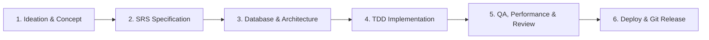

<div align="center">

# 🛠️ Agents-Kit: The Autonomous AI Engineering Hub
### Enterprise Multi-Stack Skills, Specialized Subagents, CLI Tooling & Production SDLC Workflows

**Built for Google Antigravity, Claude Code, Cursor, Windsurf, and GitHub Copilot.**

[](https://github.com/hienpham0344/Agent-kit)
[](skills/)
[](skills/)
[](agents/)
[](workflows/recipes/)
[](workflows/templates/)
[](mcp/)
[](tools/token_estimator.py)
[](tests/)
[](LICENSE)

<br/>

<p align="center">
  <a href="#-quickstart--installation"><b>Quickstart</b></a> •
  <a href="#-the-6-stage-autonomous-sdlc-lifecycle"><b>SDLC Workflows</b></a> •
  <a href="#-the-22-specialist-subagent-team"><b>Subagents</b></a> •
  <a href="#-built-in-developer-tools--cli-suite"><b>Tools & CLI</b></a> •
  <a href="#-production-mcp-servers-ecosystem"><b>MCP Servers</b></a> •
  <a href="#-the-20-curated-skill-domains-253-skills"><b>253 Skills Catalog</b></a> •
  <a href="#-token-hygiene-protocol"><b>Token Protocol</b></a>
</p>

</div>

---

## ⚡ Quickstart & Installation

### 1. Global Installation (Single Machine Setup)
Clone the repository to your local workspace and register the global CLI:

```bash
# Clone the repository
git clone https://github.com/hienpham0344/Agent-kit.git ~/Project/Agents-kit
cd ~/Project/Agents-kit

# Add CLI to your PATH environment (~/.bashrc)
./bin/agents-kit setup-env
source ~/.bashrc

# Verify your system environment and kit integrity
agents-kit doctor
```

### 2. Install into Any Target Software Project
Install the entire suite (or stack-specific presets) into any active codebase:

```bash
cd /path/to/my-project

# Auto-detect project tech stack and install optimal skills
agents-kit install . --preset auto

# Or install the full 253 skills & 22 agents suite
agents-kit install . --preset full

# Verify workspace health
agents-kit doctor
```

### 3. Available Presets
| Preset | Target Stack | Curated Categories Included |
| :--- | :--- | :--- |
| `auto` | Auto-detected | Intelligently inspects project files (`package.json`, `pom.xml`, etc.) |
| `full` | Enterprise Suite | **All 20 domains** (253 skills, 22 subagents, 9 workflows, 18 templates) |
| `web` | Frontend / Fullstack | `planning-grilling`, `engineering-core`, `design-uiux`, `documents-media`, `ops-guardrails` |
| `backend` | Server / APIs | `planning-grilling`, `engineering-core`, `architecture-domain`, `security-threat`, `stacks`, `ops-guardrails` |
| `devops` | Cloud & Infra | `ops-guardrails`, `security-threat`, `engineering-core`, `cloud-infra`, `sre-observability` |
| `security`| Red/Blue Team | `security-threat`, `security-redteam`, `ops-guardrails`, `engineering-core` |
| `minimal` | Lightweight | Core TDD, basic planning, and essentials only |

---

## 🔄 The 6-Stage Autonomous SDLC Lifecycle

Agents-kit structures every software initiative into a deterministic, test-driven 6-stage lifecycle:



| Phase | Core Objective | Key Skills | Lead Subagent | Primary Output |
| :--- | :--- | :--- | :--- | :--- |
| **1. Ideation** | Discovery, technical grilling, and stress-testing | `brainstorming`, `idea-refine`, `grill-me`, `wait-what` | `system_coordinator` | Concept Brief |
| **2. SRS** | Author formal requirements (IEEE 830) & tracer-bullet tickets | `srs-authoring`, `to-spec`, `to-tickets`, `wayfinder` | `system_coordinator` | `docs/srs/SRS-*.md`, tickets |
| **3. Database** | Relational & NoSQL modeling, ERDs, indexing, migrations | `database-design`, `domain-modeling`, `codebase-design` | `database_architect` | `docs/database/*.md`, DDL |
| **4. Coding** | Deep module architecture, TDD, and surgical file changes | `test-driven-development`, `incremental-implementation` | `frontend_developer`, `backend` | Verified code + tests |
| **5. QA & Audit** | Two-axis review, Web Vitals, accessibility, STRIDE, chaos | `verification-before-completion`, `k6-high-concurrency-testing` | `qa_reviewer`, `load_tester`, `security_auditor` | Audit logs & test passes |
| **6. Deploy & Git**| Docker builds, CI/CD, conflict resolution, PRs & release tags | `docker-and-containerization`, `cloud-and-production-deploy` | `devops_engineer`, `cloud_architect` | Dockerfile, CI/CD, PR, tag |

---

## 📖 The 9 Standard Engineering Runbooks (`workflows/recipes/`)

Deterministic, step-by-step recipes for human developers and autonomous AI coding agents:

| Runbook | Scenario | Execution Pipeline | Deliverable |
| :--- | :--- | :--- | :--- |
| **[01. Feature Development](workflows/recipes/01-feature-development-workflow.md)** | Building features from scratch | Idea $\rightarrow$ Grilling $\rightarrow$ SRS $\rightarrow$ DB $\rightarrow$ TDD $\rightarrow$ PR | Verified Feature + PR |
| **[02. Bugfix & Diagnosis](workflows/recipes/02-bugfix-and-diagnosis-workflow.md)** | Production bugs / regressions | Log Filter $\rightarrow$ Failing Test $\rightarrow$ Root Fix $\rightarrow$ Regression suite | Regression test + Hotfix |
| **[03. Codebase Refactoring](workflows/recipes/03-refactoring-and-deep-modules-workflow.md)** | Untangling spaghetti or shallow modules | Coupling Scan $\rightarrow$ Seams $\rightarrow$ Characterization Tests $\rightarrow$ Refactor | Deep Module Architecture |
| **[04. Zero-Downtime Migration](workflows/recipes/04-database-migration-workflow.md)** | Modifying live production schemas | Expand $\rightarrow$ Dual-Write/Backfill $\rightarrow$ Switch Reads $\rightarrow$ Contract | Zero-Downtime DDL |
| **[05. Git Collaboration](workflows/recipes/05-git-collaboration-and-release-workflow.md)** | Branching, merges, rebase conflicts | Conventional Commits $\rightarrow$ 3-Way Rebase Conflict $\rightarrow$ PR $\rightarrow$ SemVer | Clean Git History & Release Tag |
| **[06. AI Model Evaluation](workflows/recipes/ai-model-evaluation.md)** | Prompt regression & RAG benchmarking | Evals Matrix $\rightarrow$ Faithfulness & Context Recall $\rightarrow$ Token Budgets | Quality Gate Pass |
| **[07. Pre-Deploy Load Testing](workflows/recipes/k6-load-test-pipeline.md)** | Concurrency stress & SLA verification | k6 VU Ramp $\rightarrow$ Latency Thresholds (p95<400ms) $\rightarrow$ Pool Tuning | Performance Sign-off |
| **[08. Cloud Terraform Deploy](workflows/recipes/cloud-terraform-deployment.md)** | Safe IaC with drift detection | Format/Lint $\rightarrow$ S3 State Lock $\rightarrow$ Plan Audit $\rightarrow$ Zero Drift | Audited Cloud Infrastructure |
| **[09. Expo Mobile Release](workflows/recipes/expo-mobile-release.md)** | Cross-platform mobile store delivery | Test $\rightarrow$ EAS Cloud Build $\rightarrow$ Sentry Symbolication $\rightarrow$ Phased Rollout | Store Builds (.aab/.ipa) |

---

## 🤖 The 22 Specialist Subagent Team

Organized into 6 specialized engineering squads defined in [`agents/agents.toml`](agents/agents.toml) and [`agents/profiles/`](agents/profiles/):

### 🏗️ Planning & Architecture Squad
- **`system_coordinator`**: Coordinates complex initiatives, conducts requirements discovery, authors IEEE 830 SRS specifications, and decomposes epics into tracer-bullet tickets.
- **`database_architect`**: Specializes in relational and NoSQL database modeling, Mermaid ER diagrams, high-performance DDL schemas, and zero-downtime migrations.
- **`frontend_architect`**: High-level frontend architecture, component hierarchy planning, design tokens, and token-disciplined execution plans.

### 🎨 Design & Visual Polish Squad
- **`ui_ux_designer`**: Color harmony, typography, accessibility (WCAG AA), responsive layout systems, and UI token architecture.
- **`taste_craftsman`**: Anti-slop visual art direction, bespoke typography, distinctive character, and editorial styling.

### 💻 Core Engineering & Stacks Squad
- **`frontend_developer`**: Clean React/TypeScript/Tailwind implementation, accessible semantics, and test-first components.
- **`python_backend`**: Clean architecture, Pydantic v2 schemas, strict type-safety, and pytest test suites.
- **`java_pro`**: Java & JVM specialist, Spring Boot, Maven/Gradle build optimizations, and exception handling.
- **`mobile_dev`**: React Native, Expo Router v3, EAS CI/CD, offline-first data sync, and Hermes performance profiling.
- **`graphics_web_dev`**: Three.js WebGL 3D, WebRTC real-time media, Framer Motion springs, and Tauri native desktop apps.
- **`systems_engineer`**: Low-level systems, Rust WebAssembly, modern C/C++ memory safety (ASan), Linux eBPF, and lock-free concurrency.

### 🧪 Testing, QA & SRE Squad
- **`qa_reviewer`**: Two-axis code review, accessibility audit, pre-completion verification, and systematic debugging.
- **`load_tester`**: High-concurrency k6 load benchmarks, Locust distributed swarms, and chaos resilience injection.
- **`sre_specialist`**: Datadog APM tracing, Prometheus metrics, SLO error budgets, and blameless incident RCA.
- **`web_performance_auditor`**: Core Web Vitals (LCP, CLS, INP), bundle size minimization, and runtime profiling.

### 🔐 Security & Threat Modeling Squad
- **`security_auditor`**: Application security, STRIDE threat modeling, attack trees, and static analysis (SAST).
- **`redteam_security`**: Offensive security, penetration testing playbooks, OWASP Top 10 mitigation, container escape defense, and secret scanning.

### ☁️ Cloud, DevOps & Data Squad
- **`devops_engineer`**: Production Docker containerization, GitHub Actions CI/CD, and Git conflict resolution.
- **`cloud_architect`**: Modular Terraform IaC, Cloudflare edge compute, Supabase migrations & RLS, and Kubernetes Helm.
- **`cloud_platform_lead`**: Enterprise multi-cloud architecture spanning AWS, GCP, and Azure, Karpenter autoscaling, and BigQuery.
- **`data_scientist`**: In-memory DuckDB, Polars lazy frames, dbt data transformations, PyTorch models, and Great Expectations.
- **`ai_engineer`**: RAG evaluation, prompt regression testing, vector DB indexing, and OpenLLMetry distributed tracing.

---

## 🧰 Built-in Developer Tools & CLI Suite

```
Agents-kit CLI v4.0.0
├── bin/agents-kit           # Primary executable manager
└── tools/
    ├── token_estimator.py   # Token footprint analyzer (characters, words, context %)
    ├── ast_analyzer.py      # Python AST complexity & function signature scanner
    ├── skill_scaffolder.py  # Interactive SKILL.md generator with standard frontmatter
    └── mcp_manager.py       # MCP server discovery, verification, and diagnostics
```

### CLI Command Reference
```bash
# 1. Search across 253 skills instantly
agents-kit search "redis caching"

# 2. Check environment & internal kit health
agents-kit doctor

# 3. Discover and verify Model Context Protocol servers
agents-kit mcp
agents-kit mcp verify context-mode

# 4. Scaffold a new production skill
agents-kit create-skill redis-sentinel-failover --domain data-streaming --description "Redis Sentinel HA"

# 5. Run automated test suite
agents-kit test

# 6. Analyze token consumption on a file or prompt
python3 tools/token_estimator.py path/to/file.py

# 7. Scan Python AST complexity
python3 tools/ast_analyzer.py path/to/source/
```

---

## 🔌 Production MCP Servers Ecosystem (`mcp/servers.json`)

Pre-configured Model Context Protocol manifests ready for Antigravity, Claude Code, and Cursor:

```
[Agent / LLM] <---> [MCP Host] <---> [Production MCP Servers]
                                      ├── context-mode (Token-saving SQLite FTS5)
                                      ├── filesystem   (Scoped secure file traversal)
                                      ├── postgres     (Database query & schema profiling)
                                      ├── sqlite       (Local DB inspection)
                                      ├── github       (PRs, commits & repo operations)
                                      ├── puppeteer    (Headless browser automation & UI diffs)
                                      ├── memory       (Persistent knowledge graph memory)
                                      ├── brave-search (Live web research)
                                      ├── docker       (Container inspection & logs)
                                      └── sentry       (Production error triage)
```

---

## 📚 The 20 Curated Skill Domains (253 Skills Total)

<details>
<summary><b>1. Planning, Grilling & SRS (10 Skills)</b> — <code>skills/planning-grilling/</code></summary>

- `brainstorming`: Creative exploration before any new feature work.
- `idea-refine`: Clarifying vague concepts into structured project visions.
- `grill-me`: Interactive technical interview to resolve design decisions.
- `grill-with-docs`: Grounding requirement grilling in official documentation.
- `srs-authoring`: Authoring formal IEEE 830 software requirement specifications.
- `to-spec`: Converting user intent into unambiguous technical specifications.
- `to-tickets`: Decomposing epics into numbered, dependency-tracked tickets.
- `wayfinder`: Project orientation, architecture mapping, and onboarding.
- `writing-plans`: Step-by-step implementation planning before touching code.
- `writing-skills`: Authoring and verifying new Antigravity skills.
</details>

<details>
<summary><b>2. Architecture & Domain Modeling (10 Skills)</b> — <code>skills/architecture-domain/</code></summary>

- `clean-architecture-principles`: Separation of concerns, domain ports, and adapters.
- `codebase-design`: High-level codebase modularity, layering, and boundary enforcement.
- `database-design`: Relational and NoSQL schema design, normalization, and indexing.
- `domain-modeling`: Entity identification, aggregates, and value object modeling.
- `error-handling-patterns`: Typed exceptions, error envelopes, and resilient fallbacks.
- `solid-kiss-yagni-dry`: Pragmatic adherence to core engineering principles.
- `design-patterns`: GoF and cloud patterns (Factory, Strategy, Outbox, CQRS).
- `event-driven-architecture`: Event schemas, asynchronous decoupling, and consumers.
- `microservices-patterns`: Service boundaries, circuit breakers, and distributed contracts.
- `api-design-rest-graphql`: RESTful standards, GraphQL schemas, and versioning.
</details>

<details>
<summary><b>3. Core Engineering & TDD (10 Skills)</b> — <code>skills/engineering-core/</code></summary>

- `test-driven-development`: Strict Red-Green-Refactor test-first development.
- `systematic-debugging`: Root-cause diagnosis before proposing any fix.
- `code-review-excellence`: Two-axis code quality and security reviews.
- `requesting-code-review`: Preparing clean PRs with self-review checklists.
- `receiving-code-review`: Rigorous technical evaluation of review feedback.
- `verification-before-completion`: Pre-delivery proof and deterministic test evidence.
- `executing-plans`: Inline execution of multi-step implementation plans.
- `subagent-driven-development`: Dispatching specialized implementers and reviewers.
- `incremental-implementation`: Small, verified, atomic commits and changes.
- `diagnosing-superpowers`: Troubleshooting agent workflow failures.
</details>

<details>
<summary><b>4. Design & UI/UX Intelligence (10 Skills)</b> — <code>skills/design-uiux/</code></summary>

- `design-taste-frontend`: Anti-slop frontend art direction and visual aesthetics.
- `ui-ux-pro-max`: Design intelligence covering 79 styles, 192 palettes, and 74 font pairings.
- `design-system`: Design token architecture (colors, type, elevation, spacing).
- `ui-styling`: Stack-specific styling best practices (Tailwind, CSS Modules).
- `minimalist-ui`: Clean editorial interfaces with typography contrast.
- `industrial-brutalist-ui`: Utilitarian, terminal-inspired interface design.
- `high-end-visual-design`: High-end agency design aesthetics, micro-interactions.
- `stitch-design-taste`: Semantic design system enforcement for Google Stitch.
- `brandkit`: High-end brand guidelines boards and identity systems.
- `redesign-existing-projects`: Upgrading generic UI without breaking functionality.
</details>

<details>
<summary><b>5. Security & Threat Modeling (10 Skills)</b> — <code>skills/security-threat/</code></summary>

- `security-threat-modeling`: Systemic threat modeling and vulnerability identification.
- `stride-analysis-patterns`: STRIDE methodology for identifying threat categories.
- `attack-tree-construction`: Visualizing attack paths and finding defense gaps.
- `security-requirement-extraction`: Translating threats into actionable code controls.
- `threat-mitigation-mapping`: Mapping identified threats to security safeguards.
- `sast-configuration`: Automated static application security testing.
- `external-content-sanitizer`: Sanitizing untrusted inputs and defending against prompt injection.
- `authentication-authorization`: RBAC, ABAC, session lifecycles, and credential storage.
- `api-security-hardening`: Rate limiting, CORS, input sanitization, and header hardening.
- `cryptographic-best-practices`: Secure hashing, AES-GCM, and TLS 1.3 standards.
</details>

<details>
<summary><b>6. Stacks & Languages (10 Skills)</b> — <code>skills/stacks/</code></summary>

- `java-spring-boot`: Spring Boot, JVM performance tuning, and Maven/Gradle builds.
- `python-backend`: Pydantic v2, pytest patterns, and type-safe architecture.
- `frontend-ui-engineering`: React, Next.js App Router, Vue, and Tailwind engineering.
- `fullstack-meta-frameworks`: Server Components, SSR, ISR, and hybrid rendering.
- `golang-microservices`: Goroutines, channels, and low-latency Go services.
- `rust-systems`: Memory safety, borrow checker mastery, and zero-cost abstractions.
- `csharp-dotnet`: Modern .NET 8/9, ASP.NET Core, and Entity Framework Core.
- `nodejs-backend`: Node.js event loop, Fastify/Express, and asynchronous streams.
- `sql-and-nosql`: PostgreSQL, MySQL, Redis, and MongoDB schema architecture.
- `web-performance`: Frontend runtime profiling and Core Web Vitals optimization.
</details>

<details>
<summary><b>7. Ops, Git & Guardrails (10 Skills)</b> — <code>skills/ops-guardrails/</code></summary>

- `context-engineering-and-subagents`: Subagent coordination and token optimization.
- `docker-and-containerization`: Multi-stage Docker builds and minimal distroless containers.
- `ci-cd-pipelines`: Automated GitHub Actions workflows and quality gates.
- `cloud-and-production-deploy`: Production deployment strategies and rollback safety.
- `observability-and-monitoring`: Distributed tracing, APM, and metric instrumentation.
- `linux-and-shell-tooling`: Shell automation, text processing, and system administration.
- `dependency-management-and-lockfiles`: Lockfile integrity and security scanning.
- `git-conflict-resolution`: 3-way merge conflict diagnosis and resolution.
- `github-pr-and-collaboration`: Pull request standards and collaborative review.
- `release-and-versioning`: Semantic Versioning and automated release notes.
</details>

<details>
<summary><b>8. Documents & Media (15 Skills)</b> — <code>skills/documents-media/</code></summary>

- `readme-creation`: High-impact, beautifully structured README documentation.
- `generative_ui`: Rendering interactive HTML widgets and visual diagrams.
- `image-to-code`: Translating visual UI mockups into production code.
- `imagegen-frontend-web`: Web section reference generation.
- `imagegen-frontend-mobile`: Mobile app screen concept generation.
- `gpt-taste`: Advanced GSAP scroll motion and editorial layouts.
- `full-output-enforcement`: Overriding truncation and banning placeholders.
- `automation`: Background scheduled automation design.
- `plugin`: Packaging customizations into Antigravity plugins.
- `antigravity-guide`: Comprehensive Google Antigravity guide.
- `agy-customizations`: Antigravity customization system reference.
- `migrate-workflows`: Migrating legacy workflows to modern skills.
- `ui-plugin-navigation`: Discovering UI plugin panels.
- `using-git-worktrees`: Workspace isolation via native git worktrees.
- `using-superpowers`: Superpowers framework onboarding.
</details>

<details>
<summary><b>9. AI & LLM Application Engineering (14 Skills)</b> — <code>skills/ai-llm/</code></summary>

- `rag-evaluation`: Faithfulness, answer relevance, context recall/precision metrics.
- `prompt-engineering-evals`: Automated prompt regression matrices and judge grading.
- `vector-database-ops`: HNSW indexes, cosine distance, and pgvector/Qdrant queries.
- `llm-observability-tracing`: OpenLLMetry GenAI spans, token latency, and cost tracing.
- `function-calling-tool-use`: Strict Pydantic schemas, self-healing tool call errors.
- `synthetic-data-generation`: Evol-Instruct, dataset curation, and deduplication.
- `agentic-memory-patterns`: Working, episodic, and semantic memory patterns.
- `token-optimization-tricks`: Context-mode piping, prompt compaction, precision slicing.
- `hallucination-guardrails`: Semantic boundary enforcement and citation validation.
- `multimodal-ai-pipelines`: Document OCR, image understanding, and structured extraction.
- `local-llm-deployment`: vLLM, Ollama, AWQ, and FP8 serving.
- `langgraph-agent-workflows`: StateGraph cycles, checkpoints, and human-in-the-loop.
- `embedding-fine-tuning`: Contrastive loss (MNRL) and hard-negative mining.
- `semantic-cache-redis`: Vector prompt similarity caching for <10ms responses.
</details>

<details>
<summary><b>10. Cloud, Serverless & IaC (14 Skills)</b> — <code>skills/cloud-infra/</code></summary>

- `terraform-modular-iac`: Reusable modules, remote state locking, drift detection.
- `cloudflare-workers-pages`: Edge compute routing, cold start elimination, Wrangler.
- `cloudflare-d1-kv`: Serverless SQLite with D1, high-throughput caching with KV.
- `supabase-migrations-rls`: Declarative schema migrations, zero-leak Row-Level Security.
- `supabase-edge-functions`: Deno serverless edge endpoints with JWT verification.
- `kubernetes-helm-deployments`: Modular Helm charts, values schema validation, dry-run linting.
- `kubernetes-autoscaling-hpa`: KEDA event-driven scaling, PodDisruptionBudgets.
- `docker-multi-stage-security`: Distroless images, non-root users, Trivy vulnerability scans.
- `aws-serverless-lambda`: Graviton arm64, provisioned concurrency, cold start tuning.
- `gcp-cloud-run-patterns`: Serverless containers, VPC egress, traffic splitting.
- `gitops-argocd`: Declarative GitOps synchronization and automated rollback.
- `secrets-management-vault`: Ephemeral dynamic credentials and automated rotation.
- `zero-trust-network-access`: Cloudflare Tunnels, mTLS service-to-service auth.
- `infrastructure-cost-finops`: Waste detection, rightsizing, spot instance strategies.
</details>

<details>
<summary><b>11. Testing, Performance & Chaos (12 Skills)</b> — <code>skills/testing-performance/</code></summary>

- `k6-high-concurrency-testing`: VU ramp-up, p95/p99 latency thresholds, CI quality gates.
- `locust-distributed-load-testing`: Python-based load generation, swarm master/worker clusters.
- `chaos-engineering-resilience`: Chaos Mesh, simulated pod crashes, latency injection.
- `playwright-e2e-automation`: Accessible locators, auto-waiting, trace analysis.
- `contract-testing-pact`: Consumer-driven contracts, breaking API change prevention.
- `lighthouse-web-vitals-ci`: Core Web Vitals (LCP, CLS, INP) automated in CI.
- `fuzz-testing-security`: Mutation fuzzing for parsers, protocols, and ReDoS.
- `database-query-profiling`: EXPLAIN ANALYZE deep dive, missing index detection.
- `memory-leak-detection`: Heap snapshot comparison, V8/JVM leak isolation.
- `api-mocking-msw-wiremock`: Deterministic HTTP mock servers for third-party APIs.
- `visual-regression-testing`: Pixelmatch diffs, animation stabilization.
- `network-chaos-injection`: Toxiproxy, bandwidth throttling, packet drop simulation.
</details>

<details>
<summary><b>12. Mobile & Cross-Platform (10 Skills)</b> — <code>skills/mobile-crossplatform/</code></summary>

- `react-native-expo-architecture`: Expo Router v3, typed routes, modular hooks.
- `expo-eas-ci-cd-builds`: Automated EAS cloud builds, credentials management.
- `mobile-offline-first-sync`: SQLite/WatermelonDB local-first sync and conflict resolution.
- `hermes-engine-optimization`: Bytecode precompilation, memory profiling, TTI reduction.
- `deep-linking-universal-links`: Universal Links, App Links, domain verification.
- `mobile-secure-storage-biometrics`: Keychain/Keystore access, FaceID/TouchID auth.
- `flutter-state-management`: BLoC and Riverpod clean architecture patterns.
- `push-notifications-apns-fcm`: APNs/FCM payloads, badge updates, background handlers.
- `mobile-app-size-reduction`: ProGuard/R8 dead-code stripping, WebP compression.
- `mobile-crash-reporting-sentry`: Native symbolication (dSYM, ProGuard) with Sentry.
</details>

<details>
<summary><b>13. Data Streaming & Caching (10 Skills)</b> — <code>skills/data-streaming/</code></summary>

- `kafka-event-streaming-patterns`: Topic partitioning, dead-letter queues, idempotent producers.
- `kafka-consumer-group-tuning`: Rebalance mitigation, poll intervals, batch commits.
- `redis-distributed-caching`: Cache-Aside, write-through, TTL jitter, stampede mitigation.
- `redis-distributed-locking-redlock`: Multi-node locks, TTL expiration fencing tokens.
- `clickhouse-olap-analytics`: ReplacingMergeTree, LowCardinality, real-time aggregation.
- `rabbitmq-reliable-messaging`: Exchange topology, publisher confirms, consumer manual acks.
- `elasticsearch-search-indexing`: Inverted index tuning, autocomplete edge n-grams.
- `debezium-change-data-capture`: WAL-based CDC to Kafka for zero-downtime ETL.
- `database-sharding-partitioning`: PostgreSQL declarative range and hash partitioning.
- `event-sourcing-cqrs`: Append-only event store, asynchronous projection rebuilds.
</details>

<details>
<summary><b>14. Site Reliability & Observability (8 Skills)</b> — <code>skills/sre-observability/</code></summary>

- `datadog-apm-tracing`: Distributed spans, flame graphs, database query tracing.
- `prometheus-grafana-metrics`: 4 golden signals, PromQL alert rules, dashboards.
- `sentry-error-tracking-triage`: Error fingerprinting, issue grouping, release tracking.
- `incident-management-postmortems`: Blameless postmortems, timeline reconstruction, 5 Whys.
- `slo-sli-sla-monitoring`: Error budget calculation, multi-window burn rate alerts.
- `log-aggregation-loki-elk`: Structured JSON logs, correlation IDs, retention policies.
- `circuit-breaker-resilience4j`: State machines (Closed/Open/Half-Open), bulkheads.
- `zero-downtime-canary-deployments`: Progressive canary traffic shifting with Argo Rollouts.
</details>

<details>
<summary><b>15. Data Engineering & ML Analytics (17 Skills)</b> — <code>skills/data-ml-analytics/</code></summary>

- `duckdb-in-memory-analytics`: Direct Parquet/CSV querying with zero-copy vectorized execution.
- `polars-high-performance-df`: Rust engine, lazy evaluation, streaming mode.
- `dbt-data-transformations`: Staging/marts modeling, schema tests, DAG lineage.
- `apache-airflow-dag-orchestration`: TaskFlow API, idempotency, backfilling, retries.
- `pytorch-deep-learning-patterns`: AMP autocast, GradScaler, distributed data parallel.
- `data-validation-great-expectations`: Declarative data quality contracts and validation suites.
- `feature-store-feast`: Centralized online (Redis) and offline (Parquet) feature stores.
- `model-monitoring-evidently`: Covariate shift, KS tests, data drift detection.
- `rag-advanced-chunking`: Semantic splitting, parent-doc retrieval, markdown awareness.
- `parquet-columnar-storage-tuning`: Row group sizing, dictionary encoding, ZSTD compression.
- `jupyter-notebook-refactoring`: Notebooks to tested, modular Python packages.
- `pandas-vectorized-performance`: Replacing iterative loops with vectorized NumPy/Pandas.
- `data-lakehouse-iceberg-delta`: ACID snapshots, time travel, partition evolution.
- `automated-eda-profiling`: Visual distribution profiles and collinearity heatmaps.
- `mlflow-experiment-tracking`: Hyperparameter logging, artifact registry, model staging.
- `onnx-model-export-inference`: Compiling PyTorch models to ONNX Runtime for low latency.
- `cuda-gpu-memory-optimization`: FlashAttention-2, gradient checkpointing, memory profiling.
</details>

<details>
<summary><b>16. Advanced Web & Interactive Graphics (17 Skills)</b> — <code>skills/web-advanced-graphics/</code></summary>

- `threejs-webgl-3d`: Geometry instancing, PBR materials, draw call reduction.
- `webrtc-peer-to-peer-streaming`: SDP offer/answer, STUN/TURN, DataChannels.
- `websocket-realtime-collaboration`: Heartbeat pings, reconnect backoff, binary protocols.
- `framer-motion-animation-patterns`: Shared layout animations, exit transitions, physics springs.
- `chrome-extension-manifest-v3`: Background service workers, sandboxed content scripts.
- `tauri-cross-platform-desktop`: Lightweight webviews with secure Rust backend IPC.
- `electron-security-isolation`: Context isolation, sandboxed renderers, strict CSP.
- `web-audio-api-dsp`: Real-time DSP synthesis, AudioWorklet non-blocking threads.
- `canvas-high-fps-rendering`: OffscreenCanvas, batch path drawing, dirty rectangle clearing.
- `shader-programming-glsl`: Fragment and vertex shaders, procedural noise, signed distance fields.
- `monorepo-turborepo-orchestration`: Parallel pipelines, remote computation caching.
- `module-federation-microfrontends`: Dynamic remote loading, shared dependency singletons.
- `pwa-service-worker-caching`: Workbox caching strategies, offline fallbacks.
- `tailwind-v4-performance`: CSS `@theme` variables engine, zero runtime overhead.
- `virtual-scrolling-large-lists`: TanStack Virtual for rendering 100k+ rows smoothly.
- `web-workers-multithreading`: Comlink RPC wrapper, offloading heavy computations.
- `wasm-canvas-rendering`: Compiling Rust to WebAssembly with direct canvas pixel writes.
</details>

<details>
<summary><b>17. Offensive Security & Red Team (17 Skills)</b> — <code>skills/security-redteam/</code></summary>

- `owasp-top-10-mitigation`: Broken access control, cryptographic failures, injection defense.
- `penetration-testing-playbook`: Reconnaissance, port scanning, non-destructive PoC verification.
- `container-escape-breakout-defense`: Dropping capabilities, seccomp profiles, rootless execution.
- `secret-scanning-trufflehog`: Pre-commit high-entropy detection, Gitleaks CI integration.
- `ssrf-defense-architecture`: RFC 1918 private IP blocking, DNS rebinding mitigation.
- `sql-injection-blind-timing`: Prepared statements and query parser parameterization.
- `xss-csp-bypass-hardening`: Strict nonce-based CSP headers, DOMPurify sanitization.
- `jwt-vulnerabilities-remediation`: Rejecting 'none' algorithms, HttpOnly SameSite cookies.
- `rate-limiting-distributed-ddos`: Redis sliding window logs, token bucket algorithms.
- `cors-csrf-zero-trust`: Strict origin whitelists, SameSite cookies, anti-CSRF tokens.
- `supply-chain-dependency-audit`: SBOM generation (CycloneDX), lockfile pinning.
- `binary-hardening-aslr-dep`: PIE, stack canaries, RELRO compilation flags.
- `api-gateway-auth0-cognito`: Centralized authentication, OAuth2 scopes, token authorizers.
- `compliance-soc2-hipaa-controls`: Automated audit trails, KMS customer-managed encryption.
- `crypto-key-rotation-kms`: Envelope encryption (DEK/KEK) with AWS KMS / Vault.
- `saml-oauth2-oidc-flows`: Enterprise SSO federation, OAuth2 Authorization Code with PKCE.
- `ddos-mitigation-cloudflare-waf`: Layer 7 challenge rules, bot reputation thresholds.
</details>

<details>
<summary><b>18. Low-Level Systems & Concurrency (16 Skills)</b> — <code>skills/lowlevel-systems/</code></summary>

- `webassembly-rust-wasm`: Compiling Rust algorithms to Wasm via wasm-bindgen.
- `c-modern-memory-safety`: C17/C23 standards, AddressSanitizer (ASan), UB prevention.
- `cpp-modern-raii-concurrency`: C++20/23, smart pointers, coroutines, RAII handles.
- `rust-unsafe-code-audit`: Proving safety invariants with Miri undefined behavior checks.
- `linux-ebpf-tracing-monitoring`: Kernel tracepoints, kprobes, and XDP packet filtering.
- `simd-vectorization-optimization`: AVX2, AVX-512, and ARM NEON auto-vectorization.
- `memory-mapped-io-mmap`: POSIX mmap zero-copy virtual memory access.
- `network-socket-epoll-io_uring`: Linux epoll and asynchronous io_uring syscalls.
- `embedded-rtos-freertos`: ISR safety invariants, priority inheritance mutexes.
- `lock-free-data-structures`: Atomic CAS loops, hazard pointers, ABA mitigation.
- `cache-friendly-data-layouts`: Contiguous memory arrays, false sharing avoidance.
- `profiling-perf-valgrind`: perf CPU flame graphs, Valgrind Massif memory profiling.
- `compilation-clang-llvm-passes`: Link-Time Optimization (LTO), AST compiler passes.
- `zero-copy-serialization-flatbuffers`: Reading hierarchical binary buffers directly.
- `distributed-consensus-raft`: Leader election, log replication, split-brain protection.
- `atomic-operations-memory-order`: Acquire-release semantics, weak memory ordering models.
</details>

<details>
<summary><b>19. Enterprise Cloud: AWS, GCP & Azure (17 Skills)</b> — <code>skills/cloud-aws-gcp-azure/</code></summary>

- `aws-ecs-fargate-deployments`: Serverless containers, capacity providers, FARGATE_SPOT.
- `aws-eks-managed-kubernetes`: Karpenter just-in-time autoscaling, IRSA pod auth.
- `aws-dynamodb-single-table-design`: Composite PK/SK modeling, GSI inverted indexes.
- `aws-s3-glacier-lifecycle`: Intelligent-tiering, Glacier Instant Retrieval transitions.
- `aws-cloudfront-edge-functions`: CloudFront Functions, Lambda@Edge request rewrites.
- `aws-iam-least-privilege-policies`: Permission boundaries, scoped resource ARNs.
- `aws-sqs-sns-pubsub-decoupling`: SNS broadcast fanout to SQS queues, FIFO ordering.
- `gcp-bigquery-cost-optimization`: Partitioned and clustered tables, slot reservations.
- `gcp-gke-autopilot-clusters`: Managed control plane, per-pod compute billing.
- `gcp-pubsub-streaming-ingestion`: Global multi-zone event streams, dead-lettering.
- `gcp-cloud-spanner-distributed`: TrueTime API, globally distributed relational transactions.
- `azure-aks-container-apps`: Serverless microservices scaling with KEDA and Dapr.
- `azure-blob-storage-tiers`: Hot/Cool/Cold/Archive automated lifecycle policies.
- `azure-entra-id-workload-identities`: Federated passwordless pod and CI/CD auth.
- `multi-cloud-dr-failover`: Cross-cloud DNS failover and continuous data synchronization.
- `cloud-network-transit-gateway`: Hub-and-spoke VPC routing, centralized egress inspection.
- `aws-aurora-serverless-v2`: Fine-grained ACU auto-scaling with zero connection drops.
</details>

<details>
<summary><b>20. Developer Tooling & Productivity (16 Skills)</b> — <code>skills/developer-productivity/</code></summary>

- `advanced-git-internals-reflog-bisect`: Dangling commit recovery, automated bisect.
- `git-filter-repo-history-rewrite`: Purging accidentally committed secrets and large blobs.
- `git-worktree-multi-branch-isolation`: Parallel checkout directories from a single clone.
- `bash-strict-mode-scripting`: `set -euo pipefail`, ERR trap handlers, strict IFS.
- `make-taskfile-automation`: Cross-platform build targets, file change watch triggers.
- `neovim-lua-ide-architecture`: Tree-sitter AST, native LSP, <20ms startup times.
- `tmux-session-automation`: Persistent multi-pane terminal workspaces and pair programming.
- `ssh-tunneling-bastion-hardening`: Local/remote port forwarding, SOCKS5 dynamic proxies.
- `regex-performance-catastrophic-backtracking`: Atomic grouping, ReDoS defense.
- `ast-grep-structural-search-replace`: Syntax-aware structural code search and refactoring.
- `jq-yq-advanced-json-yaml-wrangling`: Stream processing and in-place manifest editing.
- `curl-http-debugging-automation`: DNS, TCP, TLS, and TTFB latency breakdowns.
- `systemd-service-hardening`: ProtectSystem, NoNewPrivileges, private network namespaces.
- `github-actions-custom-composite-actions`: DRY reusable CI steps and composite actions.
- `dotfiles-stow-declarative-management`: GNU Stow symlink farm automation.
- `gnupg-commit-signing-keys`: GPG and SSH cryptographic commit and tag signing.
</details>

---

## 🛡️ Token Hygiene Protocol & Context Mode Standards

Agents-kit enforces strict token conservation to minimize context window consumption and prevent reasoning degradation:

1. **Think-in-Code via Context Mode (`context-mode`)**:
   - Inspect large logs, test suites, or datasets inside sandbox subprocesses or shell pipelines (`grep`, `head`, `awk`).
   - The bulk raw bytes processed never enter LLM conversation memory; only the concise printed result enters context.
2. **Precision Slicing**:
   - Never dump whole source files (>500 lines) into context. Use targeted line slices (`StartLine` and `EndLine`).
3. **Surgical File Edits**:
   - Prefer single-chunk atomic edits over rewriting entire source files for localized adjustments.
4. **Targeted Intelligence Queries**:
   - Query UI/UX intelligence using specific flags (`--domain` or `--design-system`). Never dump raw database tables into context.
5. **Zero-Fluff Communication**:
   - Omit conversational preamble, pleasantries, re-quoting user instructions, and repeating entire files in markdown responses.

---

## 🧪 Automated Verification & Quality Assurance

Every skill, agent profile, workflow, and template in Agents-kit is validated by an automated test suite:

```bash
# Run test suite
python3 tests/test_kit.py
# Or via CLI
agents-kit test
```

```
Ran 5 tests in 0.058s
OK (253 skills validated, 22 subagents verified, 9 recipes checked, 18 templates confirmed)
```

---

## 📄 License & Attribution

Distributed under the **MIT License**. Created and maintained for autonomous AI engineering excellence.
