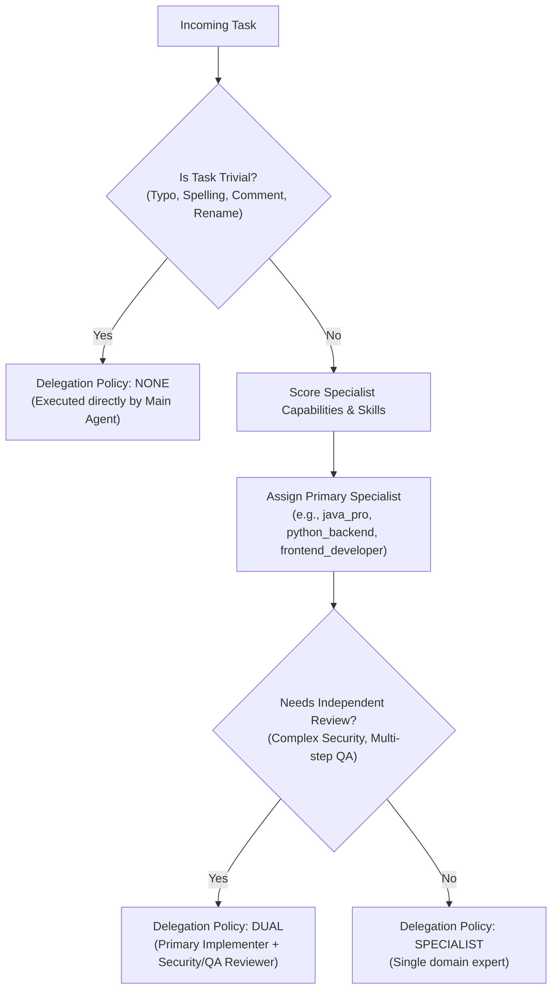

# Subagent Registry & Capability Routing Architecture

## 1. Overview
Agents-kit equips AI coding environments with **22 specialized subagent personas** defined in `agents/agents.toml` and `.github/agents/*.agent.md`.

Rather than spawning autonomous workers indiscriminately, the **Agent Router** enforces a conservative delegation policy:



---

## 2. Readiness & Dependency Verification
An agent is marked `✅ READY` if and only if:
1. Its configuration exists in `agents.toml`.
2. All referenced skills exist in the local catalog (`skills/*/*`) or aliases.
3. Required tools are supported.

Verified via:
```bash
agents-kit agents validate
```
Currently, **22 out of 22 subagents** are 100% verified and ready.
