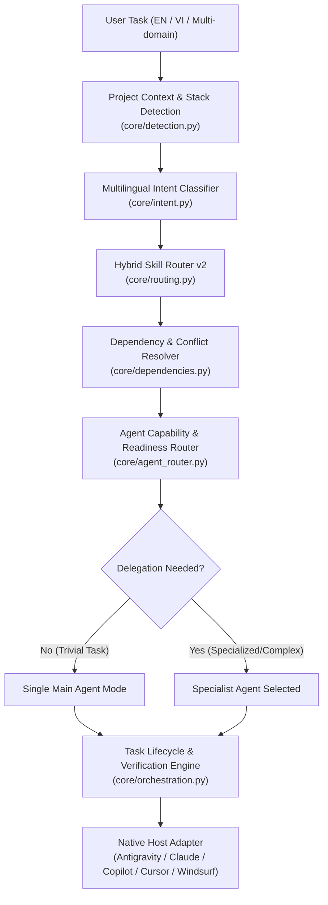

# Agent-Kit Intelligent Orchestration Upgrade Plan

**Date**: 2026-10-24  
**Architect**: Principal AI Agent Systems Architect & Quality Lead  
**Scope**: Full Orchestration Upgrade (Registry v2, Intent & Multilingual Router v2, Agent Router, Native Host Adapters, Orchestration Lifecycle Engine)

---

## 1. Current Architecture & Verified Limitations

| Component | Current State | Verified Limitation | Severity |
| :--- | :--- | :--- | :--- |
| **Skill Registry** | Basic Level 1 discovery (`core/registry.py`) | Ignores `triggers`, `aliases`, `dependencies`, `conflicts`, `risk_level` in frontmatter. Does not validate references. | P1 |
| **Skill Router** | English-only keyword matching (`core/routing.py`) | Completely fails on Vietnamese queries (e.g., `"Đăng nhập bị lỗi 401, tìm nguyên nhân"` returns 0 results). No compound intent extraction. | P0 |
| **Agent Registry** | Static TOML (`agents/agents.toml`) and `.agent.md` | No runtime model to query agent capabilities, compatibility, or missing skills. | P1 |
| **Agent Selection** | Simulated / None | No programmatic router to match task intent to specialized agent or recognize trivial tasks (preventing unnecessary delegation). | P0 |
| **Host Adapters** | Documented only (`docs/compatibility/`) | `agents-kit install` creates Antigravity/Cursor/Copilot files in fixed paths, but has no dedicated adapter abstractions or `--host` flag for Claude Code (`.claude/skills/`), Codex, or Windsurf. | P1 |
| **Orchestration Engine** | None | No dependency-aware task decomposition, explicit lifecycle states (`PENDING` $\to$ `READY` $\to$ `RUNNING` $\to$ `SUCCEEDED` / `FAILED`), bounded verification loop, or execution evidence logging. | P0 |
| **Benchmarks** | Token benchmark only | No reproducible routing dataset or quantitative precision/recall benchmark for Vietnamese & English. | P1 |

---

## 2. Proposed Target Architecture

---

## 3. Implementation Phases & Modules

1. **Phase 1: Skill Registry v2 (`core/registry.py`)**
   - Index rich metadata: `triggers`, `aliases`, `dependencies`, `conflicts`, `required_tools`, `risk_level`.
   - Circular dependency and missing dependency detection.
   - Maintain 100% backward compatibility with all 285 existing skills.

2. **Phase 2: Multilingual Intent & Hybrid Skill Router v2 (`core/intent.py`, `core/routing.py`)**
   - Unicode normalization and multilingual tokenization (Vietnamese accents & technical terms).
   - Multi-intent classification: `debugging`, `feature`, `refactoring`, `testing`, `security`, `performance`, `architecture`, `database`, `devops`, `review`.
   - Explainable scoring: intent match, trigger match, token match, framework match, conflict penalty.
   - Confidence levels: `auto_select`, `recommend`, `clarification_required`, `no_match`.

3. **Phase 3: Agent Registry & Router (`core/agent_router.py`)**
   - Model 22 subagents with capabilities, required skills, tools, and readiness checks.
   - Smart delegation policy: Simple typo/refactor $\to$ main agent; deep Spring/React/Security $\to$ specialist.
   - Explainable agent selection with dependency validation.

4. **Phase 4: Native Host Adapters (`core/hosts/`)**
   - Abstraction `HostAdapter` with implementations for:
     - `AntigravityHostAdapter` (`.agents/skills/`, `.agents/agents.toml`)
     - `ClaudeCodeHostAdapter` (`.claude/skills/`, `CLAUDE.md`)
     - `CopilotHostAdapter` (`.github/agents/`, `.github/copilot-instructions.md`)
     - `CursorHostAdapter` (`.cursorrules`)
     - `WindsurfHostAdapter` (`.windsurfrules`)
   - CLI flags: `agents-kit install . --host [antigravity|claude|copilot|cursor|windsurf|all]`.

5. **Phase 5: Orchestration & Task Lifecycle Engine (`core/orchestration.py`)**
   - States: `PENDING`, `READY`, `RUNNING`, `WAITING_APPROVAL`, `SUCCEEDED`, `FAILED`, `BLOCKED`, `CANCELLED`.
   - DAG dependency planner for compound engineering tasks (e.g. Plan $\to$ Implement $\to$ Test $\to$ Security Review).
   - Execution evidence tracking and bounded retry loops.

6. **Phase 6: Comprehensive Benchmark Suite (`tests/benchmark_routing.py`)**
   - Curated dataset of 50+ diverse test cases (Python, Java, React, DevOps, Security, Vietnamese, English, Negative cases).
   - Quantitative metrics: Precision@K, Recall@K, Top-1 Accuracy, Latency.

7. **Phase 7: CLI Integration & Documentation**
   - `agents-kit recommend "<task>" --explain --json`
   - `agents-kit plan "<task>" --project .`
   - `agents-kit agents list / validate`
   - `agents-kit benchmark routing`
   - Complete technical documentation in `docs/architecture/`.

---

## 4. Acceptance Criteria & Safety Guarantees
- Zero data loss: All operations remain non-destructive with dry-run and backup.
- Offline-first: Deterministic scoring and local Unicode processing without external API requirements.
- Full backward compatibility: All existing 12 tests pass, all 285 skills remain functional.
- Target Benchmark: Top-3 Recall $\ge 90\%$, Top-1 Accuracy $\ge 80\%$ on curated dataset.
