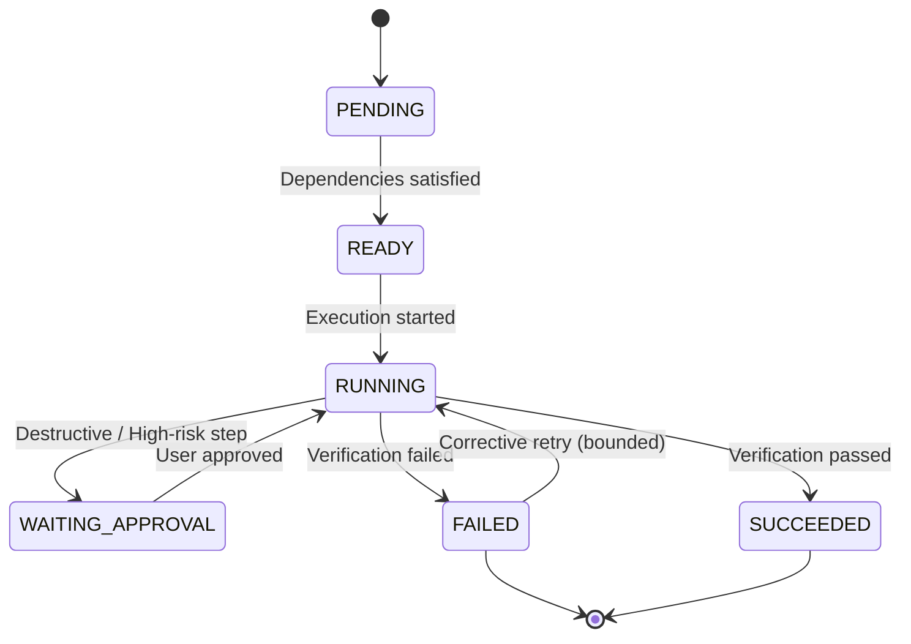

# Orchestration & Task Lifecycle Planning Engine

## 1. Task Lifecycle States
The orchestration engine models task execution using explicit state transitions:



---

## 2. Dependency-Aware Decomposition
Tasks are broken into sequential workstreams with explicit verification gates:
- **Step 1 (Analysis)**: Handled by `system_coordinator` or main agent.
- **Step 2 (Implementation)**: Handled by domain specialist (e.g., `python_backend`, `java_pro`, `frontend_developer`) with test verification commands.
- **Step 3 (Review)**: Handled by independent reviewer (`security_auditor` or `qa_reviewer`) with diff/security checks.

Run CLI command:
```bash
agents-kit plan "Build JWT login with security review" --json
```
