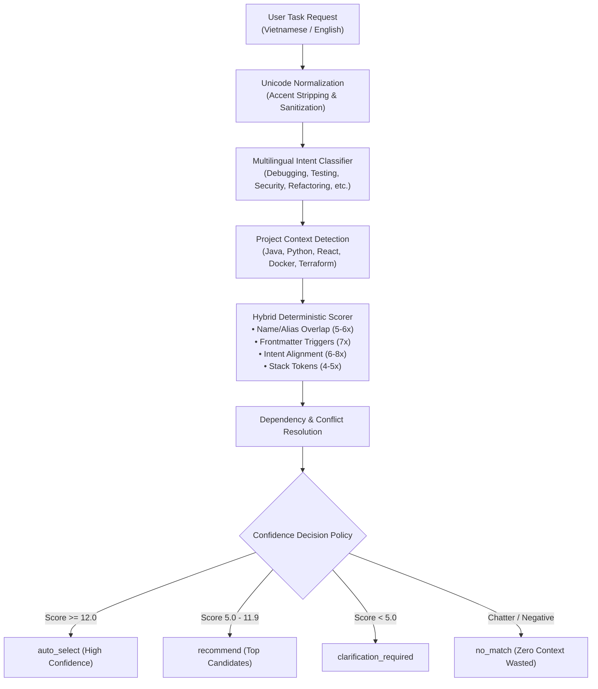

# Intelligent Skill & Multilingual Routing Architecture (v2)

## 1. Overview
The **Skill Routing Engine v2** provides deterministic, context-aware, multilingual (Vietnamese & English) skill recommendation without requiring external LLM API calls, embeddings, or vector databases.

---

## 2. Progressive Disclosure (3-Level Loading)
1. **Level 1 (Discovery)**: Minimal frontmatter indexing (`name`, `description`, `category`, `tags`). Scanning all 285 skills takes $<10\text{ ms}$.
2. **Level 2 (Selection)**: Ranking candidates using intent and project markers without touching skill bodies.
3. **Level 3 (Execution Preparation)**: Loading complete `SKILL.md` body on-demand only for the top selected skills.

---

## 3. Multilingual Support (English & Vietnamese)
The engine normalizes diacritics and technical synonyms:
- `"Sửa lỗi xác thực JWT trong Spring Boot"` $\to$ Intent: `debugging` + `security`, Tech: `spring` $\to$ Activates `jwt-vulnerabilities-remediation` and `systematic-debugging`.
- `"Đăng nhập bị lỗi 401, tìm nguyên nhân"` $\to$ Intent: `debugging` + `security` $\to$ Activates `systematic-debugging`.
