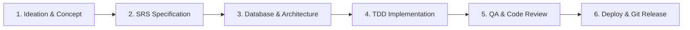

# Multi-Stack Engineering, Security & Agent Workflow Guidelines

> Single Source of Truth for Autonomous AI Coding Agents, Subagents, and Multi-Stack Engineering.

---

## 1. The Complete End-to-End SDLC Lifecycle

Every software initiative managed in this workspace follows a deterministic 6-stage lifecycle:

| Phase | Core Objective | Key Skills | Primary Agent | Deliverable |
| :--- | :--- | :--- | :--- | :--- |
| **1. Ideation** | Concept discovery, technical grilling, and stress-testing | `brainstorming`, `idea-refine`, `grill-me`, `wait-what` | `system_coordinator` | Concept Brief |
| **2. SRS** | Author formal requirements (IEEE 830) & tracer-bullet tickets | `srs-authoring`, `to-spec`, `to-tickets`, `wayfinder` | `system_coordinator` | `docs/srs/SRS-*.md`, tickets |
| **3. Database** | Relational & NoSQL modeling, ERD, indexing, and migrations | `database-design`, `domain-modeling`, `codebase-design` | `database_architect` | `docs/database/*.md`, DDL |
| **4. Coding** | Deep module architecture, TDD, and surgical file changes | `test-driven-development`, `incremental-implementation` | `frontend_developer`, `backend` | Verified code + tests |
| **5. QA & Audit** | Two-axis review, Web Vitals, accessibility, STRIDE security | `verification-before-completion`, `code-review-excellence` | `qa_reviewer`, `security_auditor` | Audit logs & test passes |
| **6. Deploy & Git** | Docker builds, CI/CD, conflict resolution, PRs & release tags | `docker-and-containerization`, `cloud-and-production-deploy` | `devops_engineer` | Dockerfile, CI/CD, PR, tag |

---

## 2. Core Operating Principles

### A. Token Hygiene & Context Efficiency
1. **Think-in-Code via Context Mode**: Delegate bulk data exploration, log filtering, and broad code searches to sandbox execution (`ctx_execute`, `ctx_search`) or bounded shell pipelines (`grep`, `head`, `awk`). Never flood chat memory with multi-KB raw outputs.
2. **Precision Slicing**: Inspect source files using targeted line slices (`StartLine`/`EndLine`). Avoid dumping entire files when only localized functions or types are needed.
3. **Surgical Edits**: Prefer atomic, single-chunk replacements over rewriting complete files.
4. **Progressive Disclosure**: Load reference manuals, design tokens, or specs on demand via specific queries.

### B. Engineering Discipline & Quality Standards
1. **SOLID Principles Compliance**:
   - **S (SRP)**: Each class/module must have only one reason to change.
   - **O (OCP)**: Prefer strategy patterns and polymorphism over cascading `switch/if-else`.
   - **L (LSP)**: Subtypes must preserve base contract semantics without throwing unexpected exceptions.
   - **I (ISP)**: Keep interfaces lean and role-focused.
   - **D (DIP)**: Core domain logic must depend on Ports (abstractions), never on low-level database or HTTP details.
2. **YAGNI (You Aren't Gonna Need It)**: Strictly ban speculative code, premature abstractions, and "future-proof" features that are not required by current acceptance criteria.
3. **KISS (Keep It Simple, Stupid)**: Prioritize readability and low cognitive load. Keep nesting depth $\le 3$ and use early-return guard clauses.
4. **DRY vs. AHA (Avoid Hasty Abstractions)**: Follow the Rule of Three. Duplication is far cheaper than the wrong abstraction; do not abstract after only two occurrences.
5. **Law of Demeter & Fail-Fast**: Talk only to immediate friends (no train wrecks `a.b.c.d()`). Validate inputs at system boundaries and fail immediately with clear errors.
6. **Grill & Align First**: For complex, ambiguous tasks, stress-test intent using interactive questioning (`grill-me`, `grill-with-docs`) before committing to code.
7. **Deep Modules (Ousterhout's Principle)**: Interfaces must be simple, thin, and intuitive; the complex implementations must be hidden deeply behind clean seams.
8. **Test-First (TDD)**: Write failing regression or unit tests *before* writing production code.
9. **Evidence Before Assertions**: Never claim a task is fixed or complete without executing the test suite and observing deterministic passing output.
10. **Zero Data Loss in Git**: Resolve merge conflicts systematically using 3-way diagnosis, never force-push to main, and verify test passes before completing a merge.

---

## 3. Skill Catalog Reference (80 Skills)

### Planning, Grilling & SRS (10 Skills)
- `brainstorming`: Creative ideation before touching features.
- `idea-refine`: Systematic criteria scoring and refinement for feature concepts.
- `grill-me` / `grilling`: Relentless technical interview to harden design logic.
- `grill-with-docs`: Technical interview that generates ADRs and Glossaries on the fly.
- `srs-authoring`: Author formal Software Requirements Specifications (IEEE 830).
- `to-spec` / `to-tickets`: Decompose conversations into tracer-bullet tickets with dependency edges.
- `wayfinder`: Strategic multi-session map for large, complex initiatives.
- `wait-what`: Emergency brake to re-pitch when AI misunderstands direction.
- `writing-plans` / `executing-plans`: Step-by-step execution workflows.

### Architecture & Database (9 Skills)
- `database-design`: Relational & NoSQL modeling, Mermaid ERDs, indexing, zero-downtime migrations.
- `codebase-design`: Deep module vocabulary, seam placement, and interface simplification.
- `domain-modeling`: Establish `GLOSSARY.md` and Architecture Decision Records (`ADR`).
- `improve-codebase-architecture`: Scan codebase for coupling, generate visual HTML reports.
- `api-and-interface-design`: Design ergonomic, future-proof public contracts.
- `authoring-developer-guide`, `authoring-technical-design`, `authoring-test-plan`: Documentation standards.
- `project-document-discovery`: Automatic source-of-truth mapping.

### Core Engineering & TDD (14 Skills)
- `test-driven-development`: Strict red-green-refactor loop.
- `systematic-debugging`: Root-cause diagnosis before proposing fixes.
- `incremental-implementation`: Small, verified, atomic commits.
- `code-simplification`: Simplify code complexity while preserving exact behavior.
- `subagent-driven-development`: Dispatch specialized subagents per subtask.
- `dispatching-parallel-agents`: Concurrent subagent execution for independent tasks.
- `code-review-excellence`: Dual-axis review (standards adherence + spec fidelity).
- `verification-before-completion`: Pre-flight verification checklist.
- `webapp-testing`: Automated web app testing with Playwright.
- `mcp-builder`: Authoring custom Model Context Protocol servers.

### Design & Frontend Craft (Anti-Slop) (14 Skills)
- `design-taste-frontend`: Curated typography, distinctive palettes, and real-browser inspection.
- `ui-ux-pro-max`: Design intelligence engine (79 styles, 192 palettes, 119 UX guidelines).
- `design-system` & `ui-styling`: Design tokens and modern CSS/Tailwind practices.
- `minimalist-skill` / `brutalist-skill` / `soft-skill`: Targeted visual aesthetics.
- `image-to-code-skill`: Accurate translation of design comps into clean components.
- `performance-optimization`: Core Web Vitals, payload trimming, and rendering optimization.
- `browser-testing-with-devtools`: Automated browser verification via DevTools / Playwright.

### Application Security & Threat Modeling (7 Skills)
- `stride-analysis-patterns`: STRIDE threat modeling.
- `attack-tree-construction`: Attack scenario trees and defense gap detection.
- `security-requirement-extraction` & `threat-mitigation-mapping`: Mapping threats to security controls.
- `sast-configuration`: Automated static application security testing.
- `external-content-sanitizer`: Prompt injection defense and untrusted input neutralization.
- `security-and-hardening`: Vulnerability remediation and input hardening.

### Stacks (Python, Java/JVM, TypeScript) (9 Skills)
- **Python**: `pydantic-v2`, `python-type-safety`, `python-testing-patterns`, `python-code-style`, `python-monorepo-architecture`.
- **Java/JVM**: Build inspection (`pom.xml`, `build.gradle`), Java 17+ conventions, `debugging-strategies`, `error-handling-patterns`.
- **TypeScript**: `setup-ts-deep-modules` (dependency-cruiser boundary enforcement).

### DevOps, Deployment & Git Operations (12 Skills)
- `docker-and-containerization`: Multi-stage Dockerfiles, caching, docker-compose, non-root security.
- `cloud-and-production-deploy`: Production readiness, Nginx reverse proxy, SSL, zero-downtime deploy.
- `git-conflict-resolution`: 3-way merge conflict diagnostics, resolution, and safe aborts.
- `github-pr-and-collaboration`: Conventional Commits, branch push, PR templates, and SemVer releases.
- `git-guardrails`: Intercept and block destructive git commands (`push --force`, `reset --hard`).
- `git-advanced-workflows`: Interactive rebasing, cherry-picking, and worktree workflows.
- `ci-cd-and-automation`: Automated GitHub Actions workflows.
- `observability-and-instrumentation`: Production metrics and structured logging.
- `wizard`: Interactive bash scripts for user-facing manual configurations.
- `token-optimization`: Maximize context economy.
- `handoff`: Session checkpointing and transition summaries.
- `triage`: Automated issue and PR triage state machine.

### Documents & Media (5 Skills)
- `docx`: Word document parsing and editing.
- `pdf`: PDF text extraction, generation, and form processing.
- `pptx`: PowerPoint deck generation and manipulation.
- `xlsx`: Spreadsheet calculations and formula audits.
- `web-artifacts-builder`: Complex interactive HTML artifact generation.
