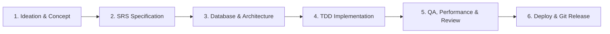

# Multi-Stack Engineering, Security & Agent Workflow Guidelines

> Single Source of Truth for Autonomous AI Coding Agents, Subagents, and Multi-Stack Engineering.

---

## 1. The Complete End-to-End SDLC Lifecycle

Every software initiative managed in this workspace follows a deterministic 6-stage lifecycle:

| Phase | Core Objective | Key Skills | Primary Agent | Deliverable |
| :--- | :--- | :--- | :--- | :--- |
| **1. Ideation** | Concept discovery, technical grilling, and stress-testing | `brainstorming`, `idea-refine`, `grill-me`, `wait-what` | `system_coordinator` | Concept Brief |
| **2. SRS** | Author formal requirements (IEEE 830) & tracer-bullet tickets | `srs-authoring`, `to-spec`, `to-tickets`, `wayfinder` | `system_coordinator` | `docs/srs/SRS-*.md`, tickets |
| **3. Database** | Relational & NoSQL modeling, ERD, indexing, and migrations | `database-design`, `domain-modeling`, `codebase-design` | `database_architect` | `docs/database/*.md`, DDL |
| **4. Coding** | Deep module architecture, TDD, and surgical file changes | `test-driven-development`, `incremental-implementation` | `frontend_developer`, `backend` | Verified code + tests |
| **5. QA & Audit** | Two-axis review, Web Vitals, accessibility, STRIDE security | `verification-before-completion`, `k6-high-concurrency-testing` | `qa_reviewer`, `load_tester`, `security_auditor` | Audit logs & test passes |
| **6. Deploy & Git** | Docker builds, CI/CD, conflict resolution, PRs & release tags | `docker-and-containerization`, `cloud-and-production-deploy` | `devops_engineer`, `cloud_architect` | Dockerfile, CI/CD, PR, tag |

---

## 2. Core Operating Principles

### A. Token Hygiene & Context Efficiency
1. **Think-in-Code via Context Mode**: Delegate bulk data exploration, log filtering, and broad code searches to sandbox execution (`ctx_execute`, `ctx_search`) or bounded shell pipelines (`grep`, `head`, `awk`). Never flood chat memory with multi-KB raw outputs.
2. **Precision Slicing**: Inspect source files using targeted line slices (`StartLine`/`EndLine`). Avoid dumping entire files when only localized functions or types are needed.
3. **Surgical Edits**: Prefer atomic, single-chunk replacements over rewriting complete files.
4. **Progressive Disclosure**: Load reference manuals, design tokens, or specs on demand via specific queries.

### B. Engineering Discipline & Quality Standards
1. **SOLID Principles Compliance**:
   - **S (SRP)**: Each class/module must have only one reason to change.
   - **O (OCP)**: Prefer strategy patterns and polymorphism over cascading `switch/if-else`.
   - **L (LSP)**: Subtypes must preserve base contract semantics without throwing unexpected exceptions.
   - **I (ISP)**: Keep interfaces lean and role-focused.
   - **D (DIP)**: Core domain logic must depend on Ports (abstractions), never on low-level database or HTTP details.
2. **YAGNI (You Aren't Gonna Need It)**: Strictly ban speculative code, premature abstractions, and "future-proof" features that are not required by current acceptance criteria.
3. **KISS (Keep It Simple, Stupid)**: Prioritize readability and low cognitive load. Keep nesting depth $\le 3$ and use early-return guard clauses.
4. **DRY vs. AHA (Avoid Hasty Abstractions)**: Follow the Rule of Three. Duplication is far cheaper than the wrong abstraction; do not abstract after only two occurrences.
5. **Law of Demeter & Fail-Fast**: Talk only to immediate friends (no train wrecks `a.b.c.d()`). Validate inputs at system boundaries and fail immediately with clear errors.
6. **Grill & Align First**: For complex, ambiguous tasks, stress-test intent using interactive questioning (`grill-me`, `grill-with-docs`) before committing to code.
7. **Deep Modules (Ousterhout's Principle)**: Interfaces must be simple, thin, and intuitive; the complex implementations must be hidden deeply behind clean seams.
8. **Test-First (TDD)**: Write failing regression or unit tests *before* writing production code.
9. **Evidence Before Assertions**: Never claim a task is fixed or complete without executing the test suite and observing deterministic passing output.
10. **Zero Data Loss in Git**: Resolve merge conflicts systematically using 3-way diagnosis, never force-push to main, and verify test passes before completing a merge.

---

## 3. The 17 Subagents Roster (`agents.toml`)

1. **`system_coordinator`**: High-level orchestrator, SRS author, ticket creator.
2. **`database_architect`**: ERD modeler, DDL designer, zero-downtime migration planner.
3. **`devops_engineer`**: Docker containerization, CI/CD pipelines, Git conflict resolution.
4. **`frontend_architect`**: Component hierarchy, state design, execution planning.
5. **`ui_ux_designer`**: Color harmony, typography, accessibility (WCAG AA), UI tokens.
6. **`taste_craftsman`**: Anti-slop visual art direction, typography, distinctive character.
7. **`frontend_developer`**: Production React/TypeScript/Tailwind implementation.
8. **`qa_reviewer`**: Two-axis code review, accessibility audit, pre-completion verification.
9. **`web_performance_auditor`**: Core Web Vitals, bundle optimization, runtime profiling.
10. **`java_pro`**: Java/Spring Boot development, Maven/Gradle, JVM performance.
11. **`python_backend`**: Python clean architecture, Pydantic v2, pytest suites.
12. **`security_auditor`**: Threat modeling (STRIDE), attack trees, SAST, content sanitization.
13. **`ai_engineer`**: RAG pipelines, LLM prompt regression evals, vector DB ops.
14. **`cloud_architect`**: Terraform IaC, Cloudflare edge compute, Supabase, Kubernetes.
15. **`sre_specialist`**: Datadog APM tracing, Prometheus metrics, SLO error budgets, postmortems.
16. **`mobile_dev`**: React Native, Expo Router v3, EAS CI/CD, offline synchronization.
17. **`load_tester`**: k6 concurrency benchmarks, Locust load clusters, chaos resilience.
